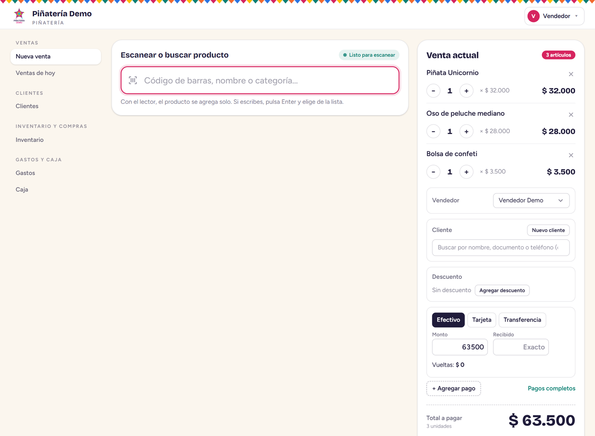
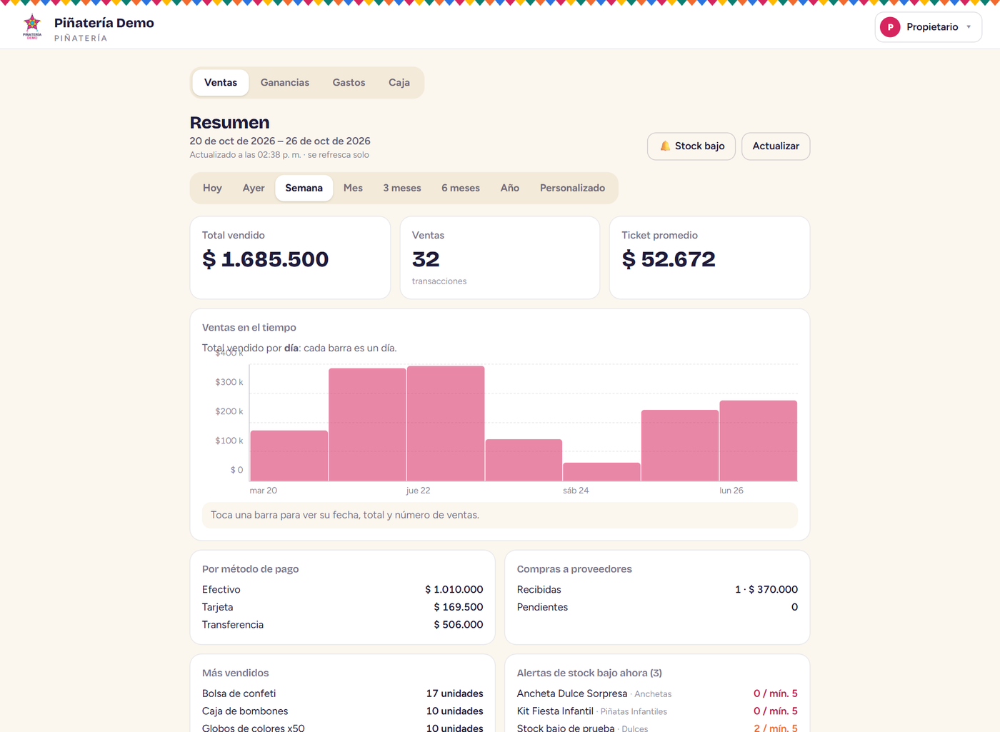
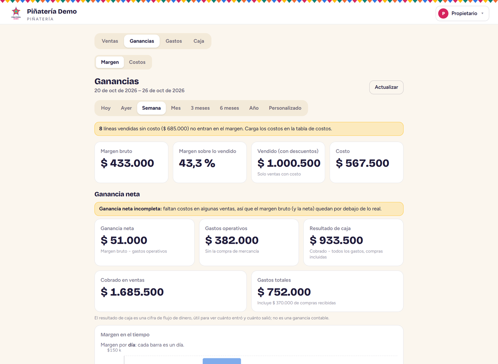
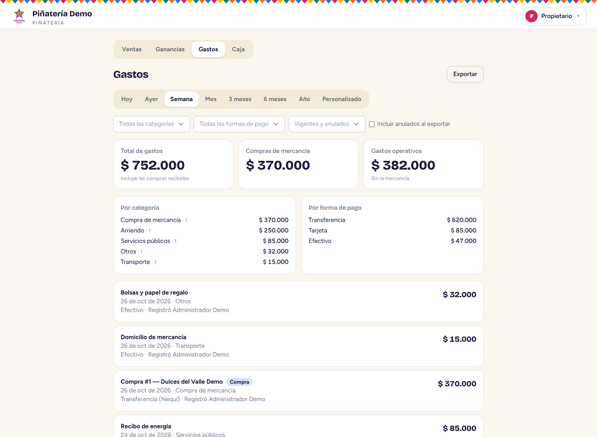
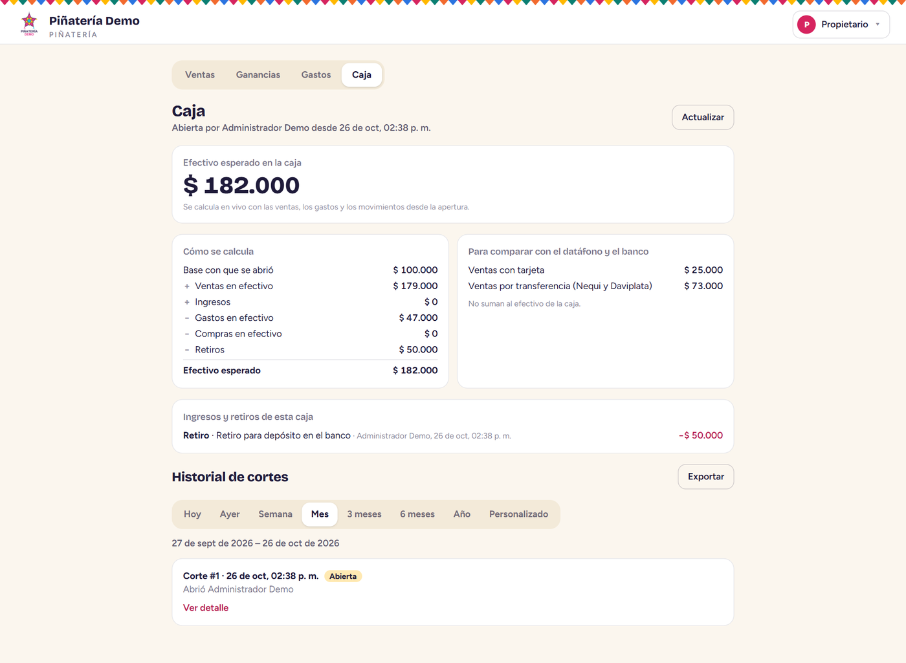
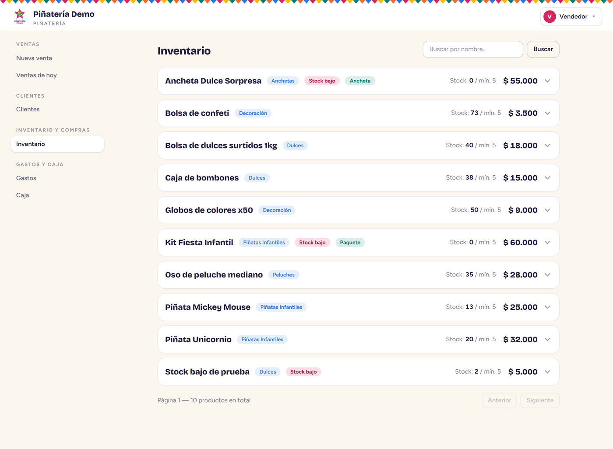
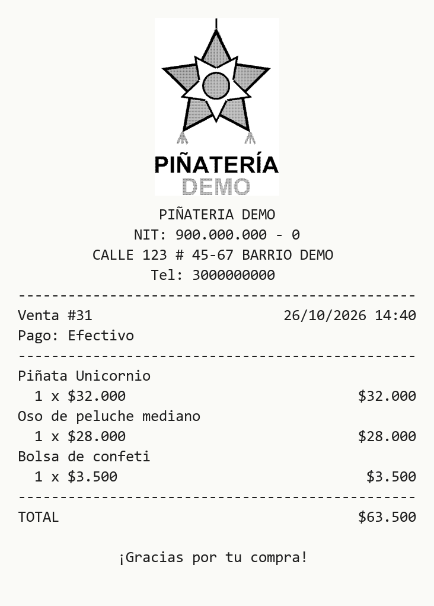

# Piñatería Demo — POS, inventario, compras, gastos y caja

Sistema web (PWA) de **punto de venta, inventario, compras, gastos y corte de caja**, hecho a la medida para una piñatería en Bogotá y en producción desde octubre de 2026. Este repositorio es la **versión pública para portafolio**: el nombre, los datos de contacto, el dominio, el logo y la infraestructura reales fueron reemplazados por datos de demostración.

> **Código de producción en repositorio privado; disponible para revisión en entrevista.**
> Las cifras de commits y pull requests de abajo son las del repositorio privado original. Este repositorio público tiene un historial nuevo, sin los commits anteriores.

## Cómo se hizo

Desarrollado por **Santiago Chávez López** con asistencia de IA (**Claude Code**). Las decisiones de producto, la arquitectura, la revisión del código y la validación con el cliente (guía de aceptación de 114 pasos ejecutada en la tienda) estuvieron a mi cargo; la IA se usó para escribir y probar código bajo esa dirección.

## Qué hace

- **Punto de venta (POS):** ventas por unidad, paquete y ancheta; lector de código de barras o búsqueda por texto; pagos mixtos (efectivo, tarjeta, transferencia con plataforma) con vueltas; descuentos con topes; ticket impreso en una Epson TM-T20II.
- **Inventario:** catálogo, stock mínimo con alertas, ajustes con historial y **productos compuestos con receta** (el paquete o la ancheta consume el stock de sus componentes).
- **Compras y proveedores:** órdenes de compra y recepción que actualiza stock y costos.
- **Gastos y caja:** ventana de gastos con categorías editables, corte de caja y ganancia neta (ventas − costo − gastos).
- **Dashboard PWA** para el propietario: ventas, ganancias, stock bajo y gastos desde el celular.
- **Clientes y Habeas Data (Ley 1581):** soporta solicitudes de titulares y autorregistro del cliente por enlace, y registra la autorización de tratamiento de datos.
- **Modo sin conexión:** el POS sigue vendiendo si se cae internet y sincroniza después, sin duplicar ventas.

### Capturas

Hechas con los datos de demostración (`scripts/seed_demo.py` más ventas, gastos y caja de ejemplo).

**Punto de venta** — carrito con tres artículos, pago y total a pagar.



**Dashboard del propietario** — ventas de la semana, por método de pago, más vendidos y alertas de stock bajo.



**Ganancias** — margen bruto y ganancia neta (margen − gastos operativos).



**Gastos** — por categoría y forma de pago, con las compras recibidas incluidas.



**Caja y corte** — efectivo esperado en vivo con su desglose, movimientos y historial de cortes.



**Inventario** — stock mínimo, alertas y productos compuestos (paquete y ancheta).



**Ticket** — texto que genera el agente de impresión (48 columnas, papel de 80 mm), con el logo arriba.



## Decisiones técnicas

| Decisión | Por qué |
|---|---|
| **Idempotencia con `uuid_cliente`** en las ventas | El POS genera un UUID por venta con índice único en la base: reenviar una venta de la cola sin conexión no la duplica. |
| **Permisos por rol y por dueño**, filtrados en el servidor | El vendedor solo ve y modifica sus propios gastos y no los que cubre un corte cerrado; el propietario consulta el Dashboard. |
| **Índice único parcial** para una sola caja abierta | `CREATE UNIQUE INDEX ... ((true)) WHERE estado = 'abierta'`: la regla la garantiza la base de datos, no la aplicación. |
| **`now()` de Postgres como único reloj** | Evita desfases entre equipos; el "día" del negocio se calcula en `America/Bogota`, no en UTC. |
| **Foto inmutable del corte de caja** | Al cerrar, el corte guarda sus totales y queda fijo, aunque después cambien los datos. |
| **Migraciones sin transformar datos** y con aprobación previa | El flujo de despliegue se detiene si hay una migración sin aprobar; se respalda antes de aplicarla. |
| **Sin datos de clientes en el navegador** | Lo guardado sin conexión (IndexedDB) es el catálogo y la cola de ventas, nunca fichas de clientes. |
| **Agente de impresión *best-effort*** | Corre en el PC del POS; si la impresora falla, la venta ya está guardada y el ticket sale igual o se reimprime. |
| **Cloudflare Tunnel** | Sin puertos abiertos en el router; Postgres, Nginx y el monitoreo escuchan solo en `127.0.0.1`. |

## Calidad y operación

- **CI** en GitHub Actions: pruebas del backend (con PostgreSQL real), del frontend y del agente de impresión.
- **Despliegue continuo con guardas:** un workflow de ejemplo (`deploy/despliegue.yml.example`) con una prueba que impide quitar sus reglas de seguridad (sin `down -v`, sin `reset --hard`, etc.). No está activo en este repositorio.
- **Respaldo diario** de PostgreSQL con Celery Beat (verificado con `pg_restore --list`, 14 días de retención) y monitoreo con Uptime Kuma.
- **Documentación** en [`docs/`](docs/README.md): visión, historias de usuario, base de datos, arquitectura, plan, estado, adendos y guía de aceptación.

## Cifras

| | |
|---|---|
| Pruebas automáticas | **582** backend + **402** frontend + **45** agente = **1.029** |
| Endpoints de la API | 77 |
| Modelos (tablas) | 22 |
| Migraciones de Alembic | 9 |
| Componentes de React | 42 |
| Commits / pull requests *(repositorio privado original)* | 196 / 82 |

## Stack

Python · FastAPI · SQLAlchemy 2 · Alembic · PostgreSQL 15 · Celery · Redis · React 18 · Vite · Tailwind v4 · Docker Compose · Nginx · Cloudflare Tunnel · Uptime Kuma · GitHub Actions · agente local ESC/POS.

## Levantarlo en local con Docker Compose

Requiere Docker, Node.js 22+ y Git. Todo corre en tu equipo, con datos de demostración.

```bash
cp .env.example .env
# Edita .env: pon una POSTGRES_PASSWORD y una SECRET_KEY (openssl rand -base64 48).
# CLOUDFLARE_TUNNEL_TOKEN puede quedar con el valor de relleno: en local no se usa el túnel.

# Frontend: se compila con la API en /api (mismo origen)
cd frontend
echo "VITE_API_BASE_URL=/api" > .env.production
npm ci && npm run build
cd ..

# Base de datos, Redis, migraciones, backend, Celery y Nginx (sin túnel ni monitoreo)
docker compose up -d --build db redis migrate backend celery_worker celery_beat nginx
docker compose ps
```

Si Docker en Windows rechaza el puerto 5432 ("ports are not available"), publica el de Postgres en otro con un `docker-compose.override.yml` local, sin tocar el archivo del repositorio:

```yaml
services:
  db:
    ports: !override
      - "127.0.0.1:54330:5432"
```

Carga los datos de demostración (usuarios, productos, una ancheta con receta, proveedores y clientes ficticios):

```bash
docker compose exec backend python -m scripts.seed_demo
```

Abre <http://127.0.0.1:8080> e ingresa con `admin`, `vendedor` o `propietario` (contraseña `Demo-12345`, solo para demostración).

### Pruebas

```bash
# Backend (necesita PostgreSQL; por ejemplo, el de Compose)
cd backend
pip install -r requirements-dev.txt
TEST_DATABASE_URL=postgresql://postgres:<tu-clave>@127.0.0.1:5432/pinateria_demo_test pytest

# Frontend
cd frontend && npm test

# Agente de impresión
cd printer-agent && pip install -r requirements-dev.txt && pytest
```

El agente de impresión (`printer-agent/`) corre en el PC del POS, no en el servidor; en desarrollo funciona en modo `mock` (guarda el ticket en una carpeta en lugar de imprimirlo). Más detalles en [`printer-agent/README.md`](printer-agent/README.md).

## Aviso

Todos los nombres, teléfonos, correos, direcciones y documentos de este repositorio son ficticios. Los manuales de usuario en PDF no se incluyen; se generan con las herramientas de [`docs/herramientas/`](docs/herramientas/README.md).
