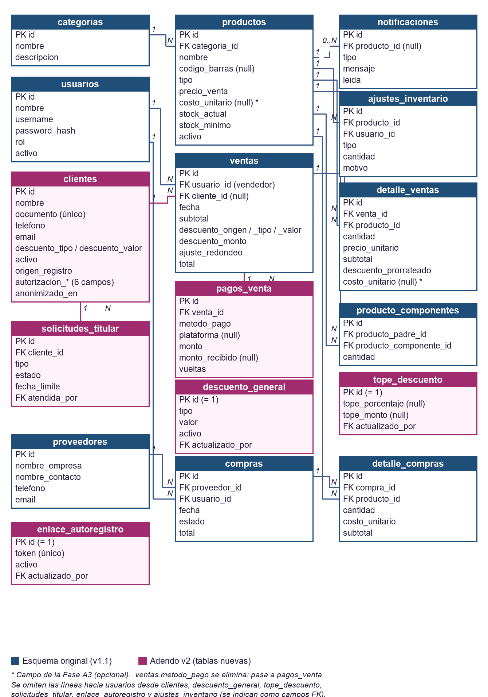

**PIÑATERÍA DEMO**

Sistema de Ventas e Inventarios

**Diseño de la Base de Datos (PostgreSQL)**

Versión 1.12 (incluye Adendo v2, Fase 9 y Adendo v3)

2026

*Confidencial – Uso interno*

# 1. Introducción y Alcance

Este documento define el diseño físico de la base de datos PostgreSQL que soporta el Sistema de Ventas e Inventarios de Piñatería Demo. El modelo traduce directamente los Requerimientos Funcionales (RF) del Documento de Visión y los criterios de aceptación definidos en las Historias de Usuario (HU-01 a HU-04), cubriendo el punto de venta, el catálogo de productos, el módulo de proveedores y compras, los ajustes de inventario y las alertas para el Dashboard remoto.

El diseño prioriza tres decisiones de negocio ya cerradas en fases previas del proyecto:

* El código de barras es opcional (codigo_barras admite NULL), ya que no todos los productos —anchetas, mermas o mercancía artesanal— cuentan con etiqueta de fábrica.

* El acceso a la información de proveedores (costos y contactos) se restringe a nivel de aplicación al rol Administrador, aunque la tabla en sí no distingue roles; el control se implementa en la capa de API (RBAC vía FastAPI/JWT).

* El stock del producto se actualiza en la misma transacción que la venta, la recepción de compra o el ajuste manual, para garantizar que nunca quede desincronizado.

**Versión 1.2.** Esta versión (a) deja el documento al día con lo implementado en las Fases 0 a 6 —el esquema de las secciones 3 a 6 coincide con la migración 0001 y con backend/schema.sql— y (b) incorpora el **Adendo v2** (sección 7): pagos mixtos con vueltas, descuentos, registro de clientes con Habeas Data, cambio de vendedor por venta y módulo de ganancias, que añade las historias HU-05 a HU-10 y los requerimientos RF-022 a RF-049 del Documento de Visión.

**Versión 1.3.** La Fase A3 se aprobó: las columnas costo_unitario de productos y detalle_ventas pasan de la migración 0004 a la 0002 (ya implementada), y se agregan las reglas de los montos de los pagos y del descuento general opcional (sección 7.8).

**Versión 1.4.** La migración 0004 (vista vw_margen_detalle) quedó implementada antes que la 0003, que se escribirá en la Fase A2 y seguirá a la 0004 (sección 7.11).

**Versión 1.5.** Precisión sobre el ajuste por redondeo en el margen (sección 7.8), según lo implementado.

Motor y convenciones: PostgreSQL 15+, nombres de tablas y columnas en snake_case y español, claves primarias autoincrementales (SERIAL), y timestamps con zona horaria (TIMESTAMPTZ) para dar soporte correcto a la diferencia horaria entre la tienda y el propietario remoto.

# 2. Modelo Entidad-Relación

El siguiente diagrama presenta las diecisiete entidades del modelo (las once del esquema original y, resaltadas en otro color, las seis nuevas del Adendo v2: pagos_venta, descuento_general, tope_descuento, clientes, enlace_autoregistro y solicitudes_titular) y sus relaciones de cardinalidad. Las líneas continuas representan relaciones obligatorias (clave foránea NOT NULL); la línea discontinua hacia notificaciones representa una relación opcional (permite NULL); producto_componentes se relaciona con productos dos veces (como padre y como componente), lo que permite representar recetas anidadas.



*Figura 1 (v1.2). Modelo entidad-relación con el Adendo v2. Las columnas nuevas de ventas, detalle_ventas y productos se detallan en la sección 7.7.*

# 3. Diccionario de Datos

## 3.1  usuarios

Cuentas de acceso al sistema. El campo rol determina los permisos: administrador (control total, incluido proveedores), vendedor (POS e inventario) y propietario (solo lectura vía Dashboard).

| Campo | Tipo | Restricciones | Descripción |
| :---- | :---- | :---- | :---- |
| id | SERIAL | PK | Identificador único. |
| nombre | VARCHAR(120) | NOT NULL | Nombre completo del usuario. |
| username | VARCHAR(60) | NOT NULL, UNIQUE | Usuario de acceso al sistema. |
| password_hash | VARCHAR(255) | NOT NULL | Hash de la contraseña (nunca texto plano). |
| rol | rol_usuario (ENUM) | NOT NULL | administrador / vendedor / propietario. |
| activo | BOOLEAN | NOT NULL, DEFAULT TRUE | Permite deshabilitar accesos sin borrar historial. |
| creado_en | TIMESTAMPTZ | NOT NULL, DEFAULT now() | Fecha de creación de la cuenta. |

**Relaciones**

* Un usuario registra muchas ventas, compras y ajustes de inventario (1..N).

* Reglas implementadas (v1.2): contraseña de 8 a 72 caracteres; un administrador no puede desactivarse a sí mismo ni quitarse el rol; los usuarios se desactivan, nunca se borran. **Adendo v2:** ventas.usuario_id pasa a ser el vendedor que realizó la venta, elegido por el POS (sección 7.7).

## 3.2  categorias

Clasificación del catálogo de productos (RF-006). Permite organizar más de 150 referencias sin límite fijo.

| Campo | Tipo | Restricciones | Descripción |
| :---- | :---- | :---- | :---- |
| id | SERIAL | PK | Identificador único. |
| nombre | VARCHAR(80) | NOT NULL, UNIQUE | Nombre de la categoría (ej. Piñatas, Anchetas, Globos). |
| descripcion | VARCHAR(255) | NULL | Descripción opcional. |

**Relaciones**

* Una categoría agrupa muchos productos (1..N). Regla implementada (v1.2): una categoría con productos asociados no se puede eliminar.

## 3.3  productos

Catálogo central del negocio. codigo_barras admite NULL para artículos sin etiqueta (HU-02); cuando existe, debe ser único, lo cual se garantiza con un índice único parcial en lugar de una restricción UNIQUE simple.

| Campo | Tipo | Restricciones | Descripción |
| :---- | :---- | :---- | :---- |
| id | SERIAL | PK | Identificador único. |
| categoria_id | INTEGER | FK → categorias.id, NOT NULL | Categoría del producto. |
| nombre | VARCHAR(150) | NOT NULL | Nombre del producto. |
| descripcion | VARCHAR(255) | NULL | Descripción opcional del producto (v1.2: se incluye en el diccionario; ya existía en el DDL). |
| codigo_barras | VARCHAR(50) | NULL, único cuando no es NULL | Código de barras opcional (RF-006). |
| tipo | tipo_producto (ENUM) | NOT NULL, DEFAULT 'unidad' | unidad / paquete / ancheta. |
| precio_venta | NUMERIC(10,2) | NOT NULL, CHECK ≥ 0 | Precio unitario de venta al público. |
| stock_actual | INTEGER | NOT NULL, DEFAULT 0, CHECK ≥ 0 | Unidades disponibles en tienda. |
| stock_minimo | INTEGER | NOT NULL, DEFAULT 5, CHECK ≥ 0 | Umbral que dispara la alerta de stock bajo (RF-008). |
| activo | BOOLEAN | NOT NULL, DEFAULT TRUE | Baja lógica del producto. |
| creado_en / actualizado_en | TIMESTAMPTZ | NOT NULL, DEFAULT now() | Trazabilidad de auditoría. |

**Relaciones**

* Pertenece a una categoría (N..1).

* Aparece en muchas líneas de detalle_ventas, detalle_compras y ajustes_inventario (1..N).

## 3.4  proveedores

Directorio de proveedores. Contiene información comercial sensible; el acceso se limita al rol Administrador desde la capa de aplicación, conforme a HU-04 (RF-012, RF-021).

| Campo | Tipo | Restricciones | Descripción |
| :---- | :---- | :---- | :---- |
| id | SERIAL | PK | Identificador único. |
| nombre_empresa | VARCHAR(150) | NOT NULL | Razón social o nombre comercial. |
| nombre_contacto | VARCHAR(120) | NULL | Persona de contacto. |
| telefono | VARCHAR(30) | NULL | Teléfono de contacto. |
| email | VARCHAR(120) | NULL | Correo de contacto. |
| direccion | VARCHAR(255) | NULL | Dirección física. |
| notas | VARCHAR(255) | NULL | Condiciones comerciales u observaciones. |
| creado_en | TIMESTAMPTZ | NOT NULL, DEFAULT now() | Fecha de alta del proveedor. |

**Relaciones**

* Un proveedor tiene muchas órdenes de compra asociadas (1..N). Regla implementada (v1.2): el teléfono se guarda solo con dígitos (7 a 15) y un proveedor con compras registradas no se puede eliminar.

## 3.5  ventas / detalle_ventas

Encabezado y líneas de cada transacción del POS (HU-01). El total de ventas se calcula como la suma de los subtotal de detalle_ventas y se persiste en ventas.total para evitar recalcularlo en cada consulta del Dashboard.

| Campo | Tipo | Restricciones | Descripción |
| :---- | :---- | :---- | :---- |
| ventas.id | SERIAL | PK | Identificador de la venta. |
| ventas.usuario_id | INTEGER | FK → usuarios.id, NOT NULL | Vendedor que realizó la venta. |
| ventas.fecha | TIMESTAMPTZ | NOT NULL, DEFAULT now() | Fecha y hora de la transacción. |
| ventas.metodo_pago | metodo_pago (ENUM) | NOT NULL | efectivo / tarjeta / transferencia. |
| ventas.total | NUMERIC(10,2) | NOT NULL, CHECK ≥ 0 | Total de la venta. |
| detalle_ventas.venta_id | INTEGER | FK → ventas.id, ON DELETE CASCADE | Venta a la que pertenece la línea. |
| detalle_ventas.producto_id | INTEGER | FK → productos.id, NOT NULL | Producto vendido. |
| detalle_ventas.cantidad | INTEGER | NOT NULL, CHECK > 0 | Unidades vendidas. |
| detalle_ventas.precio_unitario | NUMERIC(10,2) | NOT NULL, CHECK ≥ 0 | Precio al momento de la venta. |
| detalle_ventas.subtotal | NUMERIC(10,2) | NOT NULL, CHECK ≥ 0 | cantidad × precio_unitario. |

**Relaciones**

* Cada venta tiene muchas líneas de detalle (1..N); cada línea referencia un producto (N..1).

**Actualización v1.2 (código implementado)**

* El total de la venta se redondea al múltiplo de $50 más cercano (la mitad sube); la diferencia es el "ajuste por redondeo" que el ticket impreso muestra solo cuando ocurre. El historial "del día" se calcula en la zona horaria America/Bogota y no en UTC.

* **Adendo v2:** ventas.metodo_pago deja de existir: los pagos pasan a la tabla pagos_venta (sección 7.3) y se agregan columnas de subtotal, descuento y cliente (sección 7.7).

## 3.6  compras / detalle_compras

Registro de órdenes de compra a proveedores y su recepción de mercancía (RF-010, RF-011).

| Campo | Tipo | Restricciones | Descripción |
| :---- | :---- | :---- | :---- |
| compras.id | SERIAL | PK | Identificador de la orden de compra. |
| compras.proveedor_id | INTEGER | FK → proveedores.id, NOT NULL | Proveedor de la orden. |
| compras.usuario_id | INTEGER | FK → usuarios.id, NOT NULL | Administrador que registró la orden. |
| compras.fecha | TIMESTAMPTZ | NOT NULL, DEFAULT now() | Fecha de la orden. |
| compras.estado | estado_compra (ENUM) | NOT NULL, DEFAULT 'pendiente' | pendiente / recibida / cancelada. |
| compras.total | NUMERIC(10,2) | NOT NULL, DEFAULT 0, CHECK ≥ 0 | Total de la orden. |
| detalle_compras.compra_id | INTEGER | FK → compras.id, ON DELETE CASCADE | Orden a la que pertenece la línea. |
| detalle_compras.producto_id | INTEGER | FK → productos.id, NOT NULL | Producto comprado. |
| detalle_compras.cantidad | INTEGER | NOT NULL, CHECK > 0 | Unidades ordenadas/recibidas. |
| detalle_compras.costo_unitario | NUMERIC(10,2) | NOT NULL, CHECK ≥ 0 | Costo pagado al proveedor. |

**Relaciones**

* Cada compra tiene muchas líneas de detalle (1..N); al marcar una compra como recibida, el stock de cada producto se incrementa en la cantidad correspondiente.

## 3.7  ajustes_inventario

Bitácora de movimientos manuales de stock —entradas, salidas, mermas y correcciones— con motivo obligatorio, para trazabilidad completa (RF-007).

| Campo | Tipo | Restricciones | Descripción |
| :---- | :---- | :---- | :---- |
| id | SERIAL | PK | Identificador único. |
| producto_id | INTEGER | FK → productos.id, NOT NULL | Producto ajustado. |
| usuario_id | INTEGER | FK → usuarios.id, NOT NULL | Usuario responsable del ajuste. |
| tipo | tipo_ajuste (ENUM) | NOT NULL | entrada / salida / merma / correccion. |
| cantidad | INTEGER | NOT NULL, CHECK ≠ 0 | Positivo para entradas, negativo para salidas/mermas. |
| motivo | VARCHAR(255) | NOT NULL | Justificación del ajuste. |
| fecha | TIMESTAMPTZ | NOT NULL, DEFAULT now() | Fecha del movimiento. |

**Relaciones**

* Cada ajuste referencia un producto y un usuario (N..1 en ambos casos).

## 3.8  notificaciones

Persiste las alertas generadas para el Dashboard PWA del propietario (RF-013, RF-014), evitando reenviar la misma alerta repetidamente desde la cola de Celery.

| Campo | Tipo | Restricciones | Descripción |
| :---- | :---- | :---- | :---- |
| id | SERIAL | PK | Identificador único. |
| tipo | tipo_notificacion (ENUM) | NOT NULL, DEFAULT 'stock_bajo' | stock_bajo / sistema. |
| producto_id | INTEGER | FK → productos.id, ON DELETE SET NULL, NULL | Producto relacionado (si aplica). |
| mensaje | VARCHAR(255) | NOT NULL | Texto de la alerta mostrado en el Dashboard. |
| leida | BOOLEAN | NOT NULL, DEFAULT FALSE | Indica si el propietario ya la revisó. |
| creada_en | TIMESTAMPTZ | NOT NULL, DEFAULT now() | Fecha de generación. |

**Relaciones**

* Relación opcional con productos: si el producto se elimina, la notificación se conserva con producto_id en NULL.

## 3.9  producto_componentes

Tabla de composición ("receta" o Bill of Materials) para productos de tipo paquete o ancheta que se arman a partir de otros productos. Es una relación auto-referenciada sobre productos, lo que permite composición anidada: un componente puede a su vez ser un producto compuesto (ej. una ancheta puede incluir un paquete de dulces, que a su vez está hecho de dulces sueltos).

| Campo | Tipo | Restricciones | Descripción |
| :---- | :---- | :---- | :---- |
| id | SERIAL | PK | Identificador único. |
| producto_padre_id | INTEGER | FK → productos.id, ON DELETE CASCADE, NOT NULL | Producto compuesto que se arma (ej. la ancheta). |
| producto_componente_id | INTEGER | FK → productos.id, ON DELETE RESTRICT, NOT NULL | Producto consumido como ingrediente/componente. |
| cantidad | NUMERIC(10,2) | NOT NULL, CHECK > 0 | Unidades del componente requeridas por cada unidad del producto padre. |

**Relaciones**

* Un producto puede ser padre de muchos componentes, y componente de muchos productos padre (N..N sobre productos, vía esta tabla intermedia).

* La restricción UNIQUE (producto_padre_id, producto_componente_id) evita filas duplicadas para el mismo par padre-componente.

* El CHECK producto_padre_id <> producto_componente_id evita que un producto se contenga a sí mismo de forma directa (A → A); los ciclos indirectos (A → B → A) se validan en la capa de aplicación al crear o editar una receta, no en la base de datos.

Actualización v1.2: la receta se define y edita desde la interfaz de Inventario (casilla "Producto compuesto"); en la API las cantidades son enteras mayores que cero, y no se admiten componentes repetidos, inexistentes o inactivos ni ciclos. Un componente que se desactiva después sigue en la receta y su stock se sigue descontando al armar el compuesto; GET /productos/{id}/usado-en permite avisar qué compuestos lo usan antes de desactivarlo.

## 3.10  Regla de negocio: consumo de stock en productos compuestos

Esta tabla resuelve un caso real del negocio: a veces hay anchetas ya armadas esperando comprador (stock propio), y otras veces se arman sobre la demanda a partir de sus componentes. Por eso stock_actual en productos NO se elimina ni se anula para paquetes/anchetas — sigue representando las unidades ya ensambladas, listas para venta inmediata.

La regla de consumo, aplicada por el backend al confirmar una venta, es:

* Se descuenta primero de stock_actual del propio producto (lo ya armado).

* Si la cantidad vendida excede lo disponible, el faltante se resuelve recursivamente: se consultan sus filas en producto_componentes y se descuenta cada componente en proporción a la cantidad faltante.

* Si un componente es a su vez un producto compuesto, el mismo proceso se repite un nivel más abajo (recursión), lo que soporta composición anidada sin lógica adicional.

* Si un producto no tiene stock propio suficiente ni componentes definidos para cubrir el faltante, la operación falla y la venta no se confirma (no se permite dejar stock en negativo ni ventas parcialmente registradas).

Toda esta operación ocurre dentro de la misma transacción SQL de la venta (ver Documento de Arquitectura Técnica, sección 5.1), bloqueando la fila del producto con SELECT ... FOR UPDATE para evitar condiciones de carrera si dos ventas simultáneas intentan consumir el mismo stock.

# 4. Relaciones e Integridad Referencial

La política de borrado (ON DELETE) se definió según el impacto de negocio de cada relación:

* **RESTRICT** en catálogos y transacciones históricas (categorías, productos, usuarios, proveedores como referencia desde ventas, compras y ajustes): impide eliminar un registro que ya tiene movimientos asociados, protegiendo el historial contable.

* **CASCADE** únicamente entre un encabezado y sus propias líneas de detalle (ventas → detalle_ventas, compras → detalle_compras): si se anula la transacción completa, sus líneas dejan de tener sentido por separado.

* **SET NULL** en notificaciones.producto_id: una alerta histórica se conserva aunque el producto que la originó ya no exista en el catálogo.

* **CASCADE / RESTRICT mixto en producto_componentes:** si se elimina el producto padre (la ancheta), sus filas de receta se eliminan en cascada (CASCADE) porque dejan de tener sentido; pero no se puede eliminar un producto mientras siga siendo componente de otro (RESTRICT), para no dejar recetas rotas.

Adicionalmente, se aplican restricciones CHECK para reforzar reglas de negocio directamente en la base de datos (cantidades positivas, precios y stock no negativos), de modo que ningún error de la capa de aplicación pueda dejar datos inconsistentes.

# 5. Índices y Consideraciones de Rendimiento

Los índices se diseñaron directamente a partir de los criterios de aceptación de las Historias de Usuario, en particular los tiempos de respuesta exigidos por HU-01 y HU-03:

* **ux_productos_codigo_barras** — índice único parcial (WHERE codigo_barras IS NOT NULL) que permite valores NULL repetidos sin sacrificar la unicidad cuando el código sí existe; soporta el escaneo instantáneo del lector de código de barras.

* **ix_productos_nombre_trgm** — índice GIN con la extensión pg_trgm, necesario para que el buscador manual del POS devuelva coincidencias parciales por nombre en menos de 1 segundo (criterio de aceptación de HU-01).

* **ix_ventas_fecha** — acelera el cálculo de "ventas totales del día" que consulta el Dashboard PWA cada vez que el propietario lo abre (HU-03).

* **Índices sobre columnas FK** (categoria_id, venta_id, producto_id, compra_id, proveedor_id, etc.) — evitan escaneos completos de tabla en los JOIN usados por los reportes y por la vista de alertas de stock.

La vista vw_alertas_stock_bajo centraliza la condición stock_actual ≤ stock_minimo para que tanto el endpoint del Dashboard como el worker de Celery que genera notificaciones consulten la misma lógica, evitando duplicidad de reglas de negocio.

# 6. Script DDL — PostgreSQL

A continuación se incluye el script completo de creación del esquema original (migración 0001 de Alembic), tal como está en backend/schema.sql. El archivo también se entrega por separado para su ejecución directa con psql. Los cambios del Adendo v2 se encuentran en la sección 7.12.

```sql
-- ============================================================
-- Piñatería Demo — Sistema de Ventas e Inventarios
-- Esquema de Base de Datos PostgreSQL
-- Versión 1.0 — 2026
-- ============================================================

-- ---------- Extensiones ----------
-- Requerida para el índice de búsqueda parcial por nombre (HU-01)
CREATE EXTENSION IF NOT EXISTS pg_trgm;

-- ---------- Tipos enumerados ----------
CREATE TYPE rol_usuario AS ENUM ('administrador', 'vendedor', 'propietario');
CREATE TYPE tipo_producto AS ENUM ('unidad', 'paquete', 'ancheta');
CREATE TYPE metodo_pago AS ENUM ('efectivo', 'tarjeta', 'transferencia');
CREATE TYPE estado_compra AS ENUM ('pendiente', 'recibida', 'cancelada');
CREATE TYPE tipo_ajuste AS ENUM ('entrada', 'salida', 'merma', 'correccion');
CREATE TYPE tipo_notificacion AS ENUM ('stock_bajo', 'sistema');

-- ---------- usuarios ----------
CREATE TABLE usuarios (
    id              SERIAL PRIMARY KEY,
    nombre          VARCHAR(120) NOT NULL,
    username        VARCHAR(60)  NOT NULL UNIQUE,
    password_hash   VARCHAR(255) NOT NULL,
    rol             rol_usuario  NOT NULL,
    activo          BOOLEAN      NOT NULL DEFAULT TRUE,
    creado_en       TIMESTAMPTZ  NOT NULL DEFAULT now()
);

-- ---------- categorias ----------
CREATE TABLE categorias (
    id              SERIAL PRIMARY KEY,
    nombre          VARCHAR(80) NOT NULL UNIQUE,
    descripcion     VARCHAR(255)
);

-- ---------- productos ----------
CREATE TABLE productos (
    id              SERIAL PRIMARY KEY,
    nombre          VARCHAR(150) NOT NULL,
    descripcion     VARCHAR(255),
    categoria_id    INTEGER NOT NULL REFERENCES categorias(id) ON DELETE RESTRICT,
    codigo_barras   VARCHAR(50),
    tipo            tipo_producto NOT NULL DEFAULT 'unidad',
    precio_venta    NUMERIC(10,2) NOT NULL CHECK (precio_venta >= 0),
    stock_actual    INTEGER NOT NULL DEFAULT 0 CHECK (stock_actual >= 0),
    stock_minimo    INTEGER NOT NULL DEFAULT 5 CHECK (stock_minimo >= 0),
    activo          BOOLEAN NOT NULL DEFAULT TRUE,
    creado_en       TIMESTAMPTZ NOT NULL DEFAULT now(),
    actualizado_en  TIMESTAMPTZ NOT NULL DEFAULT now()
);

-- codigo_barras es opcional (permite NULL) pero único cuando existe (RF-006)
CREATE UNIQUE INDEX ux_productos_codigo_barras
    ON productos (codigo_barras)
    WHERE codigo_barras IS NOT NULL;

CREATE INDEX ix_productos_categoria ON productos (categoria_id);
CREATE INDEX ix_productos_nombre_trgm ON productos USING gin (nombre gin_trgm_ops);

-- ---------- producto_componentes (receta / Bill of Materials) ----------
-- Relación auto-referenciada sobre productos: permite composición anidada
-- (un componente puede a su vez ser un producto compuesto). Regla de negocio:
-- al vender un producto compuesto (paquete/ancheta), se descuenta primero de
-- su propio stock_actual (unidades ya armadas); el faltante se resuelve
-- recursivamente consumiendo sus componentes. stock_actual de productos
-- compuestos NO se elimina ni se vuelve NULL: sigue representando las
-- unidades ya armadas y disponibles para venta inmediata.
CREATE TABLE producto_componentes (
    id                      SERIAL PRIMARY KEY,
    producto_padre_id       INTEGER NOT NULL REFERENCES productos(id) ON DELETE CASCADE,
    producto_componente_id  INTEGER NOT NULL REFERENCES productos(id) ON DELETE RESTRICT,
    cantidad                NUMERIC(10,2) NOT NULL CHECK (cantidad > 0),

    CONSTRAINT uq_producto_componente
        UNIQUE (producto_padre_id, producto_componente_id),
    CONSTRAINT ck_no_auto_referencia
        CHECK (producto_padre_id <> producto_componente_id)
);

-- Nota: este CHECK evita que un producto se contenga a sí mismo de forma
-- directa (A -> A), pero NO evita ciclos indirectos (A -> B -> A). Esa
-- validación se hace en la capa de aplicación al crear/editar una receta.
CREATE INDEX ix_componentes_padre ON producto_componentes (producto_padre_id);
CREATE INDEX ix_componentes_hijo  ON producto_componentes (producto_componente_id);

-- ---------- proveedores ----------
-- Acceso restringido a rol Administrador a nivel de aplicación (RF-012, RF-021)
CREATE TABLE proveedores (
    id              SERIAL PRIMARY KEY,
    nombre_empresa  VARCHAR(150) NOT NULL,
    nombre_contacto VARCHAR(120),
    telefono        VARCHAR(30),
    email           VARCHAR(120),
    direccion       VARCHAR(255),
    notas           VARCHAR(255),
    creado_en       TIMESTAMPTZ NOT NULL DEFAULT now()
);

-- ---------- ventas ----------
CREATE TABLE ventas (
    id              SERIAL PRIMARY KEY,
    usuario_id      INTEGER NOT NULL REFERENCES usuarios(id) ON DELETE RESTRICT,
    fecha           TIMESTAMPTZ NOT NULL DEFAULT now(),
    metodo_pago     metodo_pago NOT NULL DEFAULT 'efectivo',
    total           NUMERIC(10,2) NOT NULL CHECK (total >= 0)
);

CREATE INDEX ix_ventas_fecha ON ventas (fecha);
CREATE INDEX ix_ventas_usuario ON ventas (usuario_id);

-- ---------- detalle_ventas ----------
CREATE TABLE detalle_ventas (
    id              SERIAL PRIMARY KEY,
    venta_id        INTEGER NOT NULL REFERENCES ventas(id) ON DELETE CASCADE,
    producto_id     INTEGER NOT NULL REFERENCES productos(id) ON DELETE RESTRICT,
    cantidad        INTEGER NOT NULL CHECK (cantidad > 0),
    precio_unitario NUMERIC(10,2) NOT NULL CHECK (precio_unitario >= 0),
    subtotal        NUMERIC(10,2) NOT NULL CHECK (subtotal >= 0)
);

CREATE INDEX ix_detalle_ventas_venta ON detalle_ventas (venta_id);
CREATE INDEX ix_detalle_ventas_producto ON detalle_ventas (producto_id);

-- ---------- compras (órdenes de compra a proveedores) ----------
CREATE TABLE compras (
    id              SERIAL PRIMARY KEY,
    proveedor_id    INTEGER NOT NULL REFERENCES proveedores(id) ON DELETE RESTRICT,
    usuario_id      INTEGER NOT NULL REFERENCES usuarios(id) ON DELETE RESTRICT,
    fecha           TIMESTAMPTZ NOT NULL DEFAULT now(),
    estado          estado_compra NOT NULL DEFAULT 'pendiente',
    total           NUMERIC(10,2) NOT NULL DEFAULT 0 CHECK (total >= 0)
);

CREATE INDEX ix_compras_proveedor ON compras (proveedor_id);
CREATE INDEX ix_compras_fecha ON compras (fecha);

-- ---------- detalle_compras ----------
CREATE TABLE detalle_compras (
    id              SERIAL PRIMARY KEY,
    compra_id       INTEGER NOT NULL REFERENCES compras(id) ON DELETE CASCADE,
    producto_id     INTEGER NOT NULL REFERENCES productos(id) ON DELETE RESTRICT,
    cantidad        INTEGER NOT NULL CHECK (cantidad > 0),
    costo_unitario  NUMERIC(10,2) NOT NULL CHECK (costo_unitario >= 0),
    subtotal        NUMERIC(10,2) NOT NULL CHECK (subtotal >= 0)
);

CREATE INDEX ix_detalle_compras_compra ON detalle_compras (compra_id);
CREATE INDEX ix_detalle_compras_producto ON detalle_compras (producto_id);

-- ---------- ajustes_inventario ----------
CREATE TABLE ajustes_inventario (
    id              SERIAL PRIMARY KEY,
    producto_id     INTEGER NOT NULL REFERENCES productos(id) ON DELETE RESTRICT,
    usuario_id      INTEGER NOT NULL REFERENCES usuarios(id) ON DELETE RESTRICT,
    tipo            tipo_ajuste NOT NULL,
    cantidad        INTEGER NOT NULL CHECK (cantidad <> 0),
    motivo          VARCHAR(255) NOT NULL,
    fecha           TIMESTAMPTZ NOT NULL DEFAULT now()
);

CREATE INDEX ix_ajustes_producto ON ajustes_inventario (producto_id);
CREATE INDEX ix_ajustes_fecha ON ajustes_inventario (fecha);

-- ---------- notificaciones (alertas de stock para el Dashboard PWA) ----------
CREATE TABLE notificaciones (
    id              SERIAL PRIMARY KEY,
    tipo            tipo_notificacion NOT NULL DEFAULT 'stock_bajo',
    producto_id     INTEGER REFERENCES productos(id) ON DELETE SET NULL,
    mensaje         VARCHAR(255) NOT NULL,
    leida           BOOLEAN NOT NULL DEFAULT FALSE,
    creada_en       TIMESTAMPTZ NOT NULL DEFAULT now()
);

CREATE INDEX ix_notificaciones_leida ON notificaciones (leida);

-- ---------- Vista: alertas de stock bajo vigentes (RF-008, RF-009) ----------
CREATE VIEW vw_alertas_stock_bajo AS
SELECT p.id, p.nombre, p.stock_actual, p.stock_minimo, c.nombre AS categoria
FROM productos p
JOIN categorias c ON c.id = p.categoria_id
WHERE p.activo = TRUE
  AND p.stock_actual <= p.stock_minimo;
```

# 7. Adendo v2 — Cambios de alcance (versión 1.2)

Este adendo documenta los cambios de base de datos que introduce el Adendo v2 al alcance del proyecto: pagos mixtos con vueltas, descuentos, registro de clientes con cumplimiento de Habeas Data, cambio de vendedor por venta y módulo de ganancias. Todo lo descrito en las secciones 1 a 6 sigue vigente y aprobado; lo nuevo se marca como **Adendo v2** y se entrega en migraciones de Alembic incrementales (0002, 0004 y 0005), una por fase del adendo (la de la Fase A2 se llamó 0005 y no 0003 porque la 0004 se implementó antes). Los nombres de tablas, columnas y tipos de este capítulo son los que usan los demás documentos del proyecto.

## 7.1  Resumen de cambios

| Elemento | Cambio | Fase del adendo | RF |
| :---- | :---- | :---- | :---- |
| pagos_venta | Tabla nueva: uno o más pagos por venta (método, plataforma, monto, monto recibido y vueltas). | A1 | RF-022, RF-023, RF-024, RF-041 |
| ventas | Se agregan subtotal, descuento_origen, descuento_tipo, descuento_valor, descuento_monto y ajuste_redondeo. Se elimina metodo_pago (pasa a pagos_venta). | A1 | RF-022, RF-027, RF-028 |
| detalle_ventas | Se agrega descuento_prorrateado (parte del descuento de la venta que corresponde a la línea). | A1 | RF-038 |
| descuento_general | Tabla nueva de una sola fila: descuento para clientes sin registro. | A1 | RF-026 |
| tope_descuento | Tabla nueva de una sola fila: topes máximos (porcentaje y monto) del descuento manual del vendedor. | A1 | RF-042 |
| notificaciones | Sin cambio de esquema: la bandeja del Dashboard usa la columna leida existente y la lista de compras se calcula con la vista vw_alertas_stock_bajo. | B1 | RF-043, RF-044, RF-045 |
| clientes | Tabla nueva: datos del cliente, descuento propio y evidencia de la autorización de tratamiento de datos. | A2 | RF-025, RF-029 a RF-035 |
| solicitudes_titular | Tabla nueva: bitácora de consultas y reclamos de los titulares (Habeas Data). | A2 | RF-035 |
| enlace_autoregistro | Tabla nueva de una sola fila: el enlace público con el que los clientes se registran solos. | A2 | RF-046, RF-048, RF-049 |
| clientes.origen_registro | Columna nueva: distingue al cliente registrado por un empleado del que se registró solo; autorizacion_registrada_por pasa a ser opcional. | A2 | RF-046 |
| ventas.cliente_id | Columna nueva: cliente asociado a la venta (opcional). | A2 | RF-031 |
| ventas.usuario_id | Sin cambio de esquema: pasa a significar "vendedor que realizó la venta", elegido en el desplegable del POS. | A2 | RF-036 |
| productos.costo_unitario | Columna nueva: costo de compra del producto, ingresado a mano (NULL = sin costo definido). Se crea en la migración 0002. | A3 | RF-037 |
| detalle_ventas.costo_unitario | Columna nueva: copia del costo al momento de la venta, para que el margen histórico no cambie si cambia el costo. Se crea en la migración 0002. | A3 | RF-038 |
| vw_clientes_resumen, vw_margen_detalle | Vistas nuevas: total comprado por cliente y margen por línea de venta. | A2 / A3 | RF-032, RF-033, RF-038 |

## 7.2  Tipos enumerados nuevos

| Tipo | Valores | Uso |
| :---- | :---- | :---- |
| plataforma_transferencia | nequi / daviplata | Plataforma de un pago por transferencia. Se llama así (y no "proveedor") para no confundirse con la tabla proveedores, que es el directorio de suplidores de mercancía. |
| tipo_descuento | porcentaje / monto | Un descuento es un porcentaje del subtotal o un monto fijo en pesos. |
| origen_descuento | ninguno / cliente / general / manual | De dónde salió el descuento aplicado a una venta. |
| medio_autorizacion | escrito / electronico / verbal | Medio por el que el titular autorizó el tratamiento de sus datos. Los autorregistros por el enlace usan electronico. |
| origen_registro | empleado / autoregistro | Quién registró al cliente: un empleado desde el POS o el propio cliente desde el enlace público. |
| tipo_solicitud_titular | consulta / actualizacion / supresion / revocatoria | Tipo de solicitud de un titular de datos. |
| estado_solicitud_titular | recibida / en_tramite / resuelta / rechazada | Estado de la solicitud. |

## 7.3  pagos_venta (Adendo v2 — Fase A1)

Un pago es una parte del total de una venta. Una venta puede tener varios pagos con métodos distintos (por ejemplo, una parte en efectivo y otra por Nequi). Reemplaza a la columna ventas.metodo_pago, que solo permitía un método por venta (RF-022, RF-023, RF-024).

| Campo | Tipo | Restricciones | Descripción |
| :---- | :---- | :---- | :---- |
| id | SERIAL | PK | Identificador único. |
| venta_id | INTEGER | FK → ventas.id, ON DELETE CASCADE, NOT NULL | Venta a la que pertenece el pago. |
| metodo_pago | metodo_pago (ENUM) | NOT NULL | efectivo / tarjeta / transferencia. |
| plataforma | plataforma_transferencia (ENUM) | NULL; solo se admite si metodo_pago = 'transferencia' | nequi / daviplata. La aplicación la exige en todo pago nuevo por transferencia; queda NULL en las transferencias anteriores al adendo, cuya plataforma no se registraba. |
| monto | NUMERIC(10,2) | NOT NULL, CHECK > 0 | Monto que este pago abona al total de la venta. |
| monto_recibido | NUMERIC(10,2) | NULL; obligatorio solo en efectivo, CHECK ≥ monto | Billete o monto que entregó el cliente en efectivo. |
| vueltas | NUMERIC(10,2) | NOT NULL, DEFAULT 0, CHECK ≥ 0 | Cambio devuelto al cliente (monto_recibido − monto). Es 0 si no es efectivo. |

**Relaciones y reglas**

* Una venta tiene uno o más pagos (1..N). Una venta con total 0 (descuento del 100 %) no requiere pagos.

* La suma de monto de los pagos de una venta debe ser exactamente igual a ventas.total. Esta regla se valida en la capa de aplicación dentro de la transacción de la venta y se verifica con pruebas automáticas.

* Las vueltas se calculan por pago en efectivo: monto_recibido − monto. Los pagos con tarjeta o transferencia no admiten monto_recibido ni vueltas.

## 7.4  descuento_general (Adendo v2 — Fase A1)

Tabla de una sola fila (id = 1) con el descuento que se ofrece por defecto a los clientes sin registro (RF-026). La modifica únicamente el administrador.

| Campo | Tipo | Restricciones | Descripción |
| :---- | :---- | :---- | :---- |
| id | SMALLINT | PK, DEFAULT 1, CHECK id = 1 | Garantiza una sola fila. |
| tipo | tipo_descuento (ENUM) | NOT NULL | porcentaje / monto. |
| valor | NUMERIC(10,2) | NOT NULL, CHECK > 0; si es porcentaje, CHECK ≤ 100 | Porcentaje (ej. 5) o monto en pesos (ej. 2000). |
| activo | BOOLEAN | NOT NULL, DEFAULT FALSE | Si está apagado, el vendedor no puede aplicar el descuento general. |
| actualizado_por | INTEGER | FK → usuarios.id, ON DELETE RESTRICT | Administrador que lo modificó por última vez. |
| actualizado_en | TIMESTAMPTZ | NOT NULL, DEFAULT now() | Fecha de la última modificación. |

### 7.4.1  tope_descuento (Adendo v2 — Fase A1)

Tabla de una sola fila (id = 1) con los topes máximos que limitan el descuento que un **vendedor** puede aplicar a mano durante la venta (RF-027, RF-042). Son dos topes independientes y el sistema exige cumplir ambos, es decir, rige el más restrictivo en cada venta. Los configura únicamente el administrador, en la misma pantalla del descuento general.

| Campo | Tipo | Restricciones | Descripción |
| :---- | :---- | :---- | :---- |
| id | SMALLINT | PK, DEFAULT 1, CHECK id = 1 | Garantiza una sola fila. |
| tope_porcentaje | NUMERIC(5,2) | NULL, CHECK > 0 y ≤ 100 | Porcentaje máximo del subtotal que el vendedor puede descontar (ej. 10). NULL = sin tope en porcentaje. |
| tope_monto | NUMERIC(10,2) | NULL, CHECK > 0 | Monto máximo en pesos que el vendedor puede descontar (ej. 5000). NULL = sin tope en monto. |
| actualizado_por | INTEGER | FK → usuarios.id, ON DELETE RESTRICT | Administrador que lo modificó por última vez. |
| actualizado_en | TIMESTAMPTZ | NOT NULL, DEFAULT now() | Fecha de la última modificación. |

**Reglas**

* Los topes se aplican al descuento que el vendedor escribe a mano (origen = manual). Los descuentos que sugiere el sistema —el propio del cliente y el general— los define el administrador y no se limitan por esta tabla.

* Cuando el usuario de la venta es administrador, los topes no aplican.

* Si el descuento manual supera cualquiera de los dos topes, el backend rechaza la venta con un mensaje que indica el límite vigente.

* Valores por defecto: ambos topes en NULL (sin límite) hasta que el administrador los configure; se recomienda configurarlos antes de poner el sistema en uso.

## 7.5  clientes (Adendo v2 — Fase A2)

Registro de clientes de la tienda (RF-029 a RF-035). Contiene datos personales, por lo que se diseñó para cumplir la Ley 1581 de 2012 (Habeas Data): no se puede crear un cliente sin registrar la evidencia de su autorización, y la supresión se hace anonimizando el registro sin perder las ventas (ver 7.8 y el Documento de Visión, Anexo A).

| Campo | Tipo | Restricciones | Descripción |
| :---- | :---- | :---- | :---- |
| id | SERIAL | PK | Identificador único. |
| nombre | VARCHAR(150) | NOT NULL | Nombre del cliente. |
| documento | VARCHAR(30) | NULL, único cuando no es NULL | Documento de identidad (opcional). |
| telefono | VARCHAR(15) | NULL | Solo dígitos (7 a 15), igual que en proveedores. |
| email | VARCHAR(120) | NULL | Correo electrónico (opcional). |
| descuento_tipo | tipo_descuento (ENUM) | NULL | Tipo del descuento propio del cliente (RF-025). |
| descuento_valor | NUMERIC(10,2) | NULL, CHECK > 0; si es porcentaje, CHECK ≤ 100; ambos descuento_\* nulos o ambos presentes | Valor del descuento propio. Lo asigna solo el administrador. |
| activo | BOOLEAN | NOT NULL, DEFAULT TRUE | Baja lógica: un cliente con ventas nunca se borra. |
| acepta_publicidad | BOOLEAN | NOT NULL, DEFAULT FALSE | Autorización APARTE (casilla propia, desmarcada por defecto) para recibir promociones. Revocar la autorización o suprimir al cliente la pone en FALSE. |
| publicidad_fecha | TIMESTAMPTZ | NULL | Cuándo se dio o se retiró esa autorización por última vez. |
| autorizacion_fecha | TIMESTAMPTZ | NOT NULL | Cuándo autorizó el tratamiento de sus datos. |
| autorizacion_medio | medio_autorizacion (ENUM) | NOT NULL | escrito / electronico / verbal. |
| autorizacion_version | VARCHAR(20) | NOT NULL | Versión de la Política de Tratamiento de Datos que aceptó (ej. "1.0"). |
| origen_registro | origen_registro (ENUM) | NOT NULL, DEFAULT 'empleado' | empleado / autoregistro. |
| autorizacion_registrada_por | INTEGER | FK → usuarios.id, ON DELETE RESTRICT, NULL; obligatorio si origen_registro = 'empleado' y NULL si es 'autoregistro' | Empleado que recogió la autorización. En un autorregistro no hay empleado. |
| autorizacion_revocada_en | TIMESTAMPTZ | NULL | Si el titular revoca la autorización, se registra cuándo. |
| anonimizado_en | TIMESTAMPTZ | NULL | Si se atendió una supresión: los datos personales se reemplazan y aquí queda la fecha. |
| creado_en / actualizado_en | TIMESTAMPTZ | NOT NULL, DEFAULT now() | Trazabilidad de auditoría. |

**Relaciones**

* Un cliente tiene muchas ventas (1..N) y muchas solicitudes de titular (1..N). ventas.cliente_id es opcional: las ventas a clientes sin registro lo dejan en NULL.

* El total comprado, el número de ventas y la última compra de cada cliente no se almacenan: se calculan con la vista vw_clientes_resumen para no duplicar datos (RF-032, RF-033).

### 7.5.1  enlace_autoregistro (Adendo v2 — Fase A2)

Tabla de una sola fila (id = 1) con el enlace público de autorregistro (RF-046, RF-048). La administra únicamente el administrador.

| Campo | Tipo | Restricciones | Descripción |
| :---- | :---- | :---- | :---- |
| id | SMALLINT | PK, DEFAULT 1, CHECK id = 1 | Garantiza una sola fila. |
| token | VARCHAR(64) | NOT NULL, UNIQUE | Código aleatorio e impredecible que forma parte del enlace. Al regenerarlo, el anterior deja de funcionar. |
| activo | BOOLEAN | NOT NULL, DEFAULT TRUE | Si se desactiva, el formulario público responde que el enlace no está disponible. |
| actualizado_por | INTEGER | FK → usuarios.id, ON DELETE RESTRICT | Administrador que lo generó o modificó por última vez. |
| actualizado_en | TIMESTAMPTZ | NOT NULL, DEFAULT now() | Fecha del último cambio. |

**Reglas**

* El envío del formulario público no requiere sesión, pero solo es válido si el token coincide y el enlace está activo.

* El formulario exige la aceptación de la política de tratamiento y registra autorizacion_medio = 'electronico', la fecha, la versión de la política y origen_registro = 'autoregistro'. No se guarda la dirección IP.

* Si ya existe un cliente con el mismo documento o teléfono, la respuesta es neutra y no revela ni modifica sus datos. El endpoint tiene límite de envíos por dirección y un campo trampa contra robots (RF-049).

* Los clientes autorregistrados no tienen descuento propio: lo asigna el administrador.

### 7.5.2  configuracion_negocio (Adendo v2 — Fase A2)

Tabla de una sola fila (id = 1) con los datos del responsable del tratamiento que se insertan en el aviso de privacidad y en la política de datos. Los edita el administrador en la aplicación; no hay variables de entorno. Se crea en la migración 0006.

| Campo | Tipo | Restricciones | Descripción |
| :---- | :---- | :---- | :---- |
| id | SMALLINT | PK, DEFAULT 1, CHECK id = 1 | Garantiza una sola fila. |
| nombre | VARCHAR(150) | NOT NULL, DEFAULT '' | Nombre o razón social. |
| documento | VARCHAR(40) | NOT NULL, DEFAULT '' | NIT o cédula. |
| direccion | VARCHAR(200) | NOT NULL, DEFAULT '' | Dirección y ciudad. |
| telefono | VARCHAR(40) | NOT NULL, DEFAULT '' | Teléfono de la tienda. |
| correo_datos | VARCHAR(120) | NOT NULL, DEFAULT '' | Correo para consultas y reclamos (cualquier correo sirve). |
| responsable_datos | VARCHAR(150) | NOT NULL, DEFAULT '' | Quién atiende las solicitudes (opcional; por defecto, el negocio). |
| politica_version | VARCHAR(20) | NOT NULL, DEFAULT '1.0' | Versión del texto de la política. |
| politica_fecha | VARCHAR(40) | NOT NULL, DEFAULT '' | Fecha desde la que rige. |
| actualizado_por | INTEGER | FK → usuarios.id, ON DELETE RESTRICT, NULL | Administrador que lo guardó por última vez. |
| actualizado_en | TIMESTAMPTZ | NOT NULL, DEFAULT now() | Fecha del último cambio. |

**Regla:** la política se considera completa cuando están nombre, documento, dirección, teléfono, correo y fecha. Mientras falte alguno, la versión que se guarda como evidencia en `clientes.autorizacion_version` es "borrador" y no se puede publicar el enlace de autorregistro.

## 7.6  solicitudes_titular (Adendo v2 — Fase A2)

Bitácora de las consultas y reclamos que presentan los titulares de los datos (derecho de conocer, actualizar, rectificar, suprimir y revocar). Permite demostrar que se atendieron dentro de los plazos legales (RF-035).

| Campo | Tipo | Restricciones | Descripción |
| :---- | :---- | :---- | :---- |
| id | SERIAL | PK | Identificador único. |
| cliente_id | INTEGER | FK → clientes.id, ON DELETE RESTRICT, NOT NULL | Titular que presenta la solicitud. |
| tipo | tipo_solicitud_titular (ENUM) | NOT NULL | consulta / actualizacion / supresion / revocatoria. |
| descripcion | VARCHAR(500) | NULL | Detalle de lo solicitado. |
| estado | estado_solicitud_titular (ENUM) | NOT NULL, DEFAULT 'recibida' | recibida / en_tramite / resuelta / rechazada. |
| recibida_en | TIMESTAMPTZ | NOT NULL, DEFAULT now() | Fecha de recepción. |
| fecha_limite | DATE | NOT NULL | Fecha máxima de respuesta según el plazo legal aplicable. |
| resuelta_en | TIMESTAMPTZ | NULL | Fecha de respuesta. |
| atendida_por | INTEGER | FK → usuarios.id, ON DELETE RESTRICT, NULL | Administrador que respondió. |
| respuesta | VARCHAR(500) | NULL | Resumen de la respuesta dada al titular. |

## 7.7  Cambios en tablas existentes

**ventas**

| Campo | Tipo | Restricciones | Descripción |
| :---- | :---- | :---- | :---- |
| usuario_id | INTEGER | (sin cambio de esquema) | Vendedor que realizó la venta, elegido en el desplegable del POS (vendedores y administradores activos). Se asigna por venta, no por ítem (RF-036). |
| registrada_por_id | INTEGER | FK → usuarios.id, ON DELETE RESTRICT, NULL | Usuario que tenía la sesión y registró la venta; puede ser distinto de usuario_id (migración 0007, 13-10-2026). NULL en las ventas anteriores, que se entienden registradas por su vendedor. Permite que el historial del vendedor muestre lo que registró a nombre de otro. |
| uuid_cliente | UUID | NULL, índice único (ux_ventas_uuid_cliente) | Identificador que genera el POS al confirmar cada venta (Fase 9, migración 0008). Reenviar la misma venta no la duplica: el servidor devuelve la existente. NULL en las ventas anteriores (el índice único admite varios NULL). |
| sin_conexion | BOOLEAN | NOT NULL, DEFAULT false | true si la venta se hizo sin conexión y se envió después (Fase 9). Sus precios y su descuento general son los que vio el cliente; el historial la rotula "Sin conexión". |
| sincronizada_en | TIMESTAMPTZ | NULL | Momento en que el servidor recibió una venta hecha sin conexión (Fase 9). `fecha` conserva la hora en que se hizo en la tienda. NULL en las demás. |
| cliente_id | INTEGER | FK → clientes.id, ON DELETE RESTRICT, NULL | Cliente asociado (Fase A2). |
| subtotal | NUMERIC(10,2) | NOT NULL, CHECK ≥ 0 | Suma de los subtotal de detalle_ventas, antes de descuento y redondeo. |
| descuento_origen | origen_descuento (ENUM) | NOT NULL, DEFAULT 'ninguno' | De dónde salió el descuento: cliente, general o manual (cambiado por el vendedor). |
| descuento_tipo | tipo_descuento (ENUM) | NULL | Tipo del descuento aplicado. |
| descuento_valor | NUMERIC(10,2) | NULL | Valor ingresado (porcentaje o monto). |
| descuento_monto | NUMERIC(10,2) | NOT NULL, DEFAULT 0, CHECK entre 0 y subtotal | Descuento en pesos efectivamente aplicado. |
| ajuste_redondeo | NUMERIC(10,2) | NOT NULL, DEFAULT 0 | Ajuste por redondeo a múltiplo de $50, calculado después del descuento (el ticket lo muestra solo cuando es distinto de 0). |
| total | NUMERIC(10,2) | CHECK total = subtotal − descuento_monto + ajuste_redondeo | Sin cambios de tipo; ahora la fórmula queda explícita en la base de datos. |
| metodo_pago | — | **Se elimina** | Pasa a pagos_venta. La migración 0002 crea un pago por cada venta existente con su método y su total antes de eliminar la columna. |

**detalle_ventas**

| Campo | Tipo | Restricciones | Descripción |
| :---- | :---- | :---- | :---- |
| descuento_prorrateado | NUMERIC(10,2) | NOT NULL, DEFAULT 0, CHECK ≥ 0 | Parte del descuento de la venta que corresponde a esta línea (Fase A1; ver 7.8). La suma de todas las líneas es igual a ventas.descuento_monto. |
| costo_unitario | NUMERIC(10,2) | NULL, CHECK ≥ 0 | Costo del producto al momento de la venta (Fase A3). NULL si el producto no tenía costo definido. |

**productos**

| Campo | Tipo | Restricciones | Descripción |
| :---- | :---- | :---- | :---- |
| costo_unitario | NUMERIC(10,2) | NULL, CHECK ≥ 0 | Costo de compra, ingresado a mano (Fase A3). NULL significa "sin costo definido". Para las anchetas el sistema muestra un costo sugerido (suma de los costos de sus componentes según producto_componentes), pero el valor guardado también es manual. |

## 7.8  Reglas de negocio del adendo

* **Orden de cálculo de una venta:** subtotal (suma de líneas) → descuento sobre el subtotal → redondeo a múltiplo de $50 → total. La suma de los pagos debe ser igual al total.

* **Descuento de la venta:** si la venta tiene cliente registrado con descuento propio, se sugiere ese (origen = cliente, Fase A2). El descuento general no se aplica solo: cada venta arranca sin descuento (origen = ninguno) y, si el general está activo, el vendedor lo aplica a quien corresponda (origen = general). Los dos son excluyentes y el del cliente tiene prioridad. El vendedor puede escribir otro descuento o cambiar el sugerido; en ese caso origen = manual y se validan los topes de la tabla tope_descuento (porcentaje máximo y monto máximo, ambos obligatorios de cumplir).

* **Prorrateo del descuento por línea:** para poder calcular el margen por producto, el descuento de la venta se reparte entre las líneas en proporción a su subtotal. Ejemplo: venta de $100.000 con un producto de $60.000 y otro de $40.000 y un descuento de $10.000; al primero le corresponden $6.000 y al segundo $4.000. El resto por redondeo de centavos se asigna a la última línea para que la suma sea exacta.

* **Margen bruto (Fase A3):** por línea = subtotal − descuento_prorrateado − (costo_unitario × cantidad). El ajuste por redondeo (unos pesos por venta) no entra en el margen: el dashboard de ganancias usa solo el ingreso neto de cada línea. Las líneas sin costo definido se excluyen del margen y se reportan como "sin costo".

* **Montos de los pagos:** en pesos enteros. En efectivo, el monto y el monto recibido deben ser múltiplos de $50 (la moneda mínima); tarjeta y transferencia aceptan cualquier monto entero. Estas reglas las valida la aplicación, no la base de datos.

* **Vueltas:** solo existen en pagos en efectivo. El POS muestra el monto recibido y las vueltas, y el ticket las imprime.

* **Habeas Data:** no se puede insertar un cliente sin los campos autorizacion_\*. La revocatoria marca autorizacion_revocada_en y bloquea el uso del cliente en ventas nuevas. La supresión reemplaza nombre por "Cliente anonimizado", pone en NULL documento, telefono, email y descuento propio, y registra anonimizado_en; pone en NULL la descripción de todas las solicitudes del cliente (decisión del 13-10-2026); las ventas históricas se conservan (son registro contable) sin datos que identifiquen a la persona. Cuando el cliente se registra solo por el enlace público, el sistema exige la casilla de aceptación y guarda el medio electronico y la versión de la política; no hay empleado asociado.

## 7.9  Vistas nuevas

* **vw_clientes_resumen** (Fase A2): una fila por cliente con numero_ventas, total_comprado (suma de ventas.total) y ultima_compra. Alimenta la ficha del cliente y el filtro por rangos (RF-032, RF-033).

* **vw_margen_detalle** (Fase A3): una fila por línea de venta con ingreso neto (subtotal − descuento_prorrateado), costo total y margen. El dashboard de ganancias agrupa esta vista por producto y por periodo (RF-038, RF-039).

## 7.10  Índices nuevos

* **ix_pagos_venta_venta** y **ix_pagos_venta_metodo**: acelera el detalle de una venta y el total por método de pago del dashboard (que ahora se calcula por monto recibido, RF-041).

* **ux_clientes_documento**: índice único parcial (WHERE documento IS NOT NULL), igual que el de codigo_barras.

* **ix_clientes_nombre_trgm**: índice GIN con pg_trgm para la búsqueda parcial por nombre, que debe responder en menos de 1 segundo como el buscador de productos. **ix_clientes_telefono** para la búsqueda por teléfono.

* **ix_ventas_cliente**: historial de ventas por cliente.

* **ix_ventas_registrada_por**: historial del vendedor con lo que registró a nombre de otro (migración 0007).

* **ux_ventas_uuid_cliente**: índice único sobre ventas.uuid_cliente; hace idempotente el envío de ventas (Fase 9, migración 0008).

* **ix_solicitudes_cliente** e **ix_solicitudes_estado**: seguimiento de solicitudes pendientes.

## 7.11  Migraciones (Alembic)

| Migración | Fase | Contenido |
| :---- | :---- | :---- |
| 0001 | Base | Esquema inicial (secciones 3 a 6). Ya aplicada en producción. |
| 0002 | A1 | Tipos nuevos, pagos_venta, descuento_general, tope_descuento, columnas de descuento en ventas y detalle_ventas y, como la Fase A3 se aprobó, las columnas costo_unitario de productos y detalle_ventas; migra ventas.metodo_pago a pagos_venta, calcula subtotal y ajuste_redondeo de las ventas existentes y elimina metodo_pago. Implementada el 08-10-2026. |
| 0005 | A2 | clientes, solicitudes_titular, enlace_autoregistro, ventas.cliente_id, índices y vw_clientes_resumen (en este diseño se llamaba 0003; en Alembic sigue a la 0004); incluye las columnas clientes.acepta_publicidad y publicidad_fecha. No transforma datos. Implementada el 12-10-2026; la tabla enlace_autoregistro queda vacía hasta que el administrador genere el enlace. |
| 0006 | A2 | configuracion_negocio (sección 7.5.2): datos del responsable para la política de datos, editables desde la aplicación. No transforma datos. Implementada el 13-10-2026. |
| 0007 | A2 | ventas.registrada_por_id (opcional, con su índice ix_ventas_registrada_por). No transforma datos: las ventas anteriores quedan en NULL. Implementada el 13-10-2026. |
| 0008 | Fase 9 | ventas.uuid_cliente (con índice único ux_ventas_uuid_cliente), ventas.sin_conexion (por defecto false) y ventas.sincronizada_en, todas opcionales. No transforma datos: las ventas anteriores quedan con uuid_cliente y sincronizada_en en NULL y sin_conexion en false. Se ensayó subir, bajar y volver a subir con una venta previa. Implementada el 14-10-2026. |
| 0004 | A3 | vw_margen_detalle (las columnas de costo ya se crean en la 0002). Implementada el 08-10-2026, antes que la de la Fase A2: en Alembic sigue a la 0002, y la de la Fase A2 (0005) sigue a la 0004. |

Antes de aplicar cada migración en producción se genera un respaldo manual (ver Documento de Arquitectura, sección 8). La migración 0002 es la única que transforma datos existentes.

## 7.12  Script DDL del Adendo v2

```sql
-- ============================================================
-- Adendo v2 — Migración 0002 (Fase A1): pagos mixtos y descuentos
-- ============================================================
CREATE TYPE plataforma_transferencia AS ENUM ('nequi', 'daviplata');
CREATE TYPE tipo_descuento AS ENUM ('porcentaje', 'monto');
CREATE TYPE origen_descuento AS ENUM ('ninguno', 'cliente', 'general', 'manual');

CREATE TABLE pagos_venta (
    id              SERIAL PRIMARY KEY,
    venta_id        INTEGER NOT NULL REFERENCES ventas(id) ON DELETE CASCADE,
    metodo_pago     metodo_pago NOT NULL,
    plataforma      plataforma_transferencia,
    monto           NUMERIC(10,2) NOT NULL CHECK (monto > 0),
    monto_recibido  NUMERIC(10,2),
    vueltas         NUMERIC(10,2) NOT NULL DEFAULT 0 CHECK (vueltas >= 0),
    -- La plataforma solo aplica a transferencias; la aplicación la exige en pagos nuevos
    -- (las transferencias históricas migradas quedan con plataforma NULL).
    CONSTRAINT ck_pago_plataforma
        CHECK (plataforma IS NULL OR metodo_pago = 'transferencia'),
    CONSTRAINT ck_pago_efectivo CHECK (
        (metodo_pago = 'efectivo' AND monto_recibido IS NOT NULL
            AND monto_recibido >= monto AND vueltas = monto_recibido - monto)
        OR (metodo_pago <> 'efectivo' AND monto_recibido IS NULL AND vueltas = 0)
    )
);
CREATE INDEX ix_pagos_venta_venta  ON pagos_venta (venta_id);
CREATE INDEX ix_pagos_venta_metodo ON pagos_venta (metodo_pago);

CREATE TABLE tope_descuento (
    id              SMALLINT PRIMARY KEY DEFAULT 1 CHECK (id = 1),
    tope_porcentaje NUMERIC(5,2)  CHECK (tope_porcentaje > 0 AND tope_porcentaje <= 100),
    tope_monto      NUMERIC(10,2) CHECK (tope_monto > 0),
    actualizado_por INTEGER REFERENCES usuarios(id) ON DELETE RESTRICT,
    actualizado_en  TIMESTAMPTZ NOT NULL DEFAULT now()
);

CREATE TABLE descuento_general (
    id              SMALLINT PRIMARY KEY DEFAULT 1 CHECK (id = 1),
    tipo            tipo_descuento NOT NULL,
    valor           NUMERIC(10,2) NOT NULL CHECK (valor > 0),
    activo          BOOLEAN NOT NULL DEFAULT FALSE,
    actualizado_por INTEGER REFERENCES usuarios(id) ON DELETE RESTRICT,
    actualizado_en  TIMESTAMPTZ NOT NULL DEFAULT now(),
    CONSTRAINT ck_descuento_general_porcentaje CHECK (tipo <> 'porcentaje' OR valor <= 100)
);

ALTER TABLE ventas
    ADD COLUMN subtotal          NUMERIC(10,2),
    ADD COLUMN descuento_origen  origen_descuento NOT NULL DEFAULT 'ninguno',
    ADD COLUMN descuento_tipo    tipo_descuento,
    ADD COLUMN descuento_valor   NUMERIC(10,2),
    ADD COLUMN descuento_monto   NUMERIC(10,2) NOT NULL DEFAULT 0 CHECK (descuento_monto >= 0),
    ADD COLUMN ajuste_redondeo   NUMERIC(10,2) NOT NULL DEFAULT 0;

ALTER TABLE detalle_ventas
    ADD COLUMN descuento_prorrateado NUMERIC(10,2) NOT NULL DEFAULT 0 CHECK (descuento_prorrateado >= 0);

-- Costos de la Fase A3, adelantados a la 0002 porque A3 se aprobó.
ALTER TABLE productos
    ADD COLUMN costo_unitario NUMERIC(10,2) CHECK (costo_unitario >= 0);
ALTER TABLE detalle_ventas
    ADD COLUMN costo_unitario NUMERIC(10,2) CHECK (costo_unitario >= 0);

-- Datos existentes: subtotal = suma de líneas; ajuste = total - subtotal; un pago por venta.
UPDATE ventas v SET
    subtotal = (SELECT COALESCE(SUM(d.subtotal), 0) FROM detalle_ventas d WHERE d.venta_id = v.id);
UPDATE ventas SET ajuste_redondeo = total - subtotal;
ALTER TABLE ventas ALTER COLUMN subtotal SET NOT NULL;
ALTER TABLE ventas ADD CONSTRAINT ck_ventas_subtotal CHECK (subtotal >= 0);
ALTER TABLE ventas ADD CONSTRAINT ck_ventas_descuento CHECK (descuento_monto <= subtotal);
ALTER TABLE ventas ADD CONSTRAINT ck_ventas_total_coherente
    CHECK (total = subtotal - descuento_monto + ajuste_redondeo);

INSERT INTO pagos_venta (venta_id, metodo_pago, monto, monto_recibido, vueltas)
SELECT id, metodo_pago, total, CASE WHEN metodo_pago = 'efectivo' THEN total END, 0
FROM ventas WHERE total > 0;

ALTER TABLE ventas DROP COLUMN metodo_pago;

-- ============================================================
-- Adendo v2 — Migración 0005 (Fase A2; en este diseño era la 0003): clientes y Habeas Data
-- ============================================================
CREATE TYPE medio_autorizacion AS ENUM ('escrito', 'electronico', 'verbal');
CREATE TYPE tipo_solicitud_titular AS ENUM ('consulta', 'actualizacion', 'supresion', 'revocatoria');
CREATE TYPE estado_solicitud_titular AS ENUM ('recibida', 'en_tramite', 'resuelta', 'rechazada');
CREATE TYPE origen_registro AS ENUM ('empleado', 'autoregistro');

CREATE TABLE clientes (
    id                          SERIAL PRIMARY KEY,
    nombre                      VARCHAR(150) NOT NULL,
    documento                   VARCHAR(30),
    telefono                    VARCHAR(15),
    email                       VARCHAR(120),
    descuento_tipo              tipo_descuento,
    descuento_valor             NUMERIC(10,2),
    activo                      BOOLEAN NOT NULL DEFAULT TRUE,
    autorizacion_fecha          TIMESTAMPTZ NOT NULL,
    autorizacion_medio          medio_autorizacion NOT NULL,
    autorizacion_version        VARCHAR(20) NOT NULL,
    origen_registro             origen_registro NOT NULL DEFAULT 'empleado',
    autorizacion_registrada_por INTEGER REFERENCES usuarios(id) ON DELETE RESTRICT,
    autorizacion_revocada_en    TIMESTAMPTZ,
    anonimizado_en              TIMESTAMPTZ,
    creado_en                   TIMESTAMPTZ NOT NULL DEFAULT now(),
    actualizado_en              TIMESTAMPTZ NOT NULL DEFAULT now(),
    CONSTRAINT ck_cliente_registrador
        CHECK ((origen_registro = 'empleado') = (autorizacion_registrada_por IS NOT NULL)),
    CONSTRAINT ck_cliente_descuento_completo
        CHECK ((descuento_tipo IS NULL) = (descuento_valor IS NULL)),
    CONSTRAINT ck_cliente_descuento_valor
        CHECK (descuento_valor IS NULL OR (descuento_valor > 0
               AND (descuento_tipo <> 'porcentaje' OR descuento_valor <= 100)))
);
CREATE UNIQUE INDEX ux_clientes_documento ON clientes (documento) WHERE documento IS NOT NULL;
CREATE INDEX ix_clientes_nombre_trgm ON clientes USING gin (nombre gin_trgm_ops);
CREATE INDEX ix_clientes_telefono ON clientes (telefono);

CREATE TABLE enlace_autoregistro (
    id              SMALLINT PRIMARY KEY DEFAULT 1 CHECK (id = 1),
    token           VARCHAR(64) NOT NULL UNIQUE,
    activo          BOOLEAN NOT NULL DEFAULT TRUE,
    actualizado_por INTEGER REFERENCES usuarios(id) ON DELETE RESTRICT,
    actualizado_en  TIMESTAMPTZ NOT NULL DEFAULT now()
);

ALTER TABLE ventas
    ADD COLUMN cliente_id INTEGER REFERENCES clientes(id) ON DELETE RESTRICT;
CREATE INDEX ix_ventas_cliente ON ventas (cliente_id);

CREATE TABLE solicitudes_titular (
    id              SERIAL PRIMARY KEY,
    cliente_id      INTEGER NOT NULL REFERENCES clientes(id) ON DELETE RESTRICT,
    tipo            tipo_solicitud_titular NOT NULL,
    descripcion     VARCHAR(500),
    estado          estado_solicitud_titular NOT NULL DEFAULT 'recibida',
    recibida_en     TIMESTAMPTZ NOT NULL DEFAULT now(),
    fecha_limite    DATE NOT NULL,
    resuelta_en     TIMESTAMPTZ,
    atendida_por    INTEGER REFERENCES usuarios(id) ON DELETE RESTRICT,
    respuesta       VARCHAR(500)
);
CREATE INDEX ix_solicitudes_cliente ON solicitudes_titular (cliente_id);
CREATE INDEX ix_solicitudes_estado  ON solicitudes_titular (estado);

CREATE VIEW vw_clientes_resumen AS
SELECT c.id AS cliente_id,
       COUNT(v.id)                    AS numero_ventas,
       COALESCE(SUM(v.total), 0)      AS total_comprado,
       MAX(v.fecha)                   AS ultima_compra
FROM clientes c
LEFT JOIN ventas v ON v.cliente_id = c.id
GROUP BY c.id;

-- ============================================================
-- Adendo v2 — Migración 0004 (Fase A3): ganancias
-- (las columnas costo_unitario ya se crean en la migración 0002)
-- ============================================================

CREATE VIEW vw_margen_detalle AS
SELECT d.id AS detalle_id, d.venta_id, d.producto_id, v.fecha, v.usuario_id,
       d.cantidad,
       d.subtotal - d.descuento_prorrateado             AS ingreso_neto,
       d.costo_unitario * d.cantidad                    AS costo_total,
       d.subtotal - d.descuento_prorrateado
           - d.costo_unitario * d.cantidad              AS margen
FROM detalle_ventas d
JOIN ventas v ON v.id = d.venta_id;
```

# 8. Adendo v3 — Gastos y corte de caja (versión 1.12)

Este capítulo documenta los cambios de base de datos del Adendo v3 (19-10-2026): gastos con categorías editables, compras unificadas con los gastos y corte de caja. Todo lo descrito en los capítulos anteriores sigue vigente. **Estado: implementado: la G1 con la migración 0009 y la G2 con la 0010; la G3 no tiene tablas.** Los nombres de tablas, columnas y tipos de este capítulo son los que usan el código y los demás documentos (diseño funcional en el documento 12). El diagrama entidad-relación (Figura 1) todavía no incluye las tablas del Adendo v3.

## 8.1  Resumen de cambios

| Elemento | Cambio | Fase | RF |
| :---- | :---- | :---- | :---- |
| categorias_gasto | Tabla nueva: categorías de gasto editables; una es de sistema ("Compra de mercancía"). Se siembran categorías iniciales. | G1 | RF-060 |
| gastos | Tabla nueva: un gasto con su categoría, monto, forma de pago, quién lo registró, edición y anulación. | G1 | RF-059, RF-061, RF-062, RF-075 |
| compras.metodo_pago, compras.plataforma, compras.recibida_en | Columnas nuevas y opcionales: cómo y cuándo se pagó y se recibió la compra. | G1 | RF-063, RF-064 |
| vw_gastos_unificados | Vista nueva: une los gastos y las compras recibidas. | G1 | RF-063, RF-065, RF-066 |
| cortes_caja | Tabla nueva: apertura y cierre de la caja, con la foto de las cifras del corte. | G2 | RF-069, RF-070, RF-072, RF-073 |
| movimientos_caja | Tabla nueva: ingresos y retiros manuales de una caja abierta. | G2 | RF-071 |

## 8.2  Tipos enumerados nuevos

| Tipo | Valores | Uso |
| :---- | :---- | :---- |
| estado_corte_caja | abierta / cerrada | Estado de un corte de caja. |
| tipo_movimiento_caja | ingreso / retiro | Movimiento manual de efectivo en una caja abierta. |

Los gastos y las compras reutilizan los tipos `metodo_pago` (efectivo / tarjeta / transferencia) y `plataforma_transferencia` (nequi / daviplata) del Adendo v2.

## 8.3  categorias_gasto (Adendo v3 — Fase G1)

| Campo | Tipo | Restricciones | Descripción |
| :---- | :---- | :---- | :---- |
| id | SERIAL | PK | Identificador único. |
| nombre | VARCHAR(60) | NOT NULL; índice único sobre lower(nombre) | Nombre de la categoría (primera letra en mayúscula, RF-058). |
| activa | BOOLEAN | NOT NULL, DEFAULT true | Una categoría desactivada no se ofrece para gastos nuevos pero conserva los antiguos. |
| es_sistema | BOOLEAN | NOT NULL, DEFAULT false | true solo en "Compra de mercancía": no se renombra ni se desactiva. |
| creada_en | TIMESTAMPTZ | NOT NULL, DEFAULT now() | Fecha de creación. |

**Siembra (migración 0009):** Compra de mercancía (de sistema), Arriendo, Servicios públicos, Nómina, Transporte, Publicidad, Mantenimiento, Impuestos y Otros. Las categorías no se borran (los gastos las referencian con ON DELETE RESTRICT); se desactivan.

## 8.4  gastos (Adendo v3 — Fase G1)

| Campo | Tipo | Restricciones | Descripción |
| :---- | :---- | :---- | :---- |
| id | SERIAL | PK | Identificador único. |
| fecha | DATE | NOT NULL, DEFAULT el día de hoy en America/Bogota | Día contable del gasto; los informes y la ganancia neta la usan. El vendedor siempre registra con la de hoy; el administrador puede elegir una anterior (nunca futura, validado en la aplicación). |
| categoria_id | INTEGER | FK → categorias_gasto.id, ON DELETE RESTRICT, NOT NULL | Categoría del gasto. |
| descripcion | VARCHAR(255) | NOT NULL | Qué se pagó (primera letra en mayúscula). |
| beneficiario | VARCHAR(120) | NULL | A quién se pagó, en texto libre; no se enlaza a proveedores (el directorio es solo del administrador). |
| monto | NUMERIC(10,2) | NOT NULL, CHECK > 0 | Monto en pesos enteros; en efectivo, múltiplo de $50 (lo valida la aplicación). |
| metodo_pago | metodo_pago (ENUM) | NOT NULL | efectivo / tarjeta / transferencia. |
| plataforma | plataforma_transferencia (ENUM) | NULL; CHECK: solo si metodo_pago = 'transferencia' | nequi / daviplata; la aplicación la exige en toda transferencia nueva. |
| registrado_por_id | INTEGER | FK → usuarios.id, ON DELETE RESTRICT, NOT NULL | Quien lo registró. Define de quién es el gasto para los permisos del vendedor. |
| creado_en | TIMESTAMPTZ | NOT NULL, DEFAULT now() | Hora real del registro; la caja y el bloqueo por corte la usan (no `fecha`). |
| actualizado_en | TIMESTAMPTZ | NULL | Última edición. |
| actualizado_por_id | INTEGER | FK → usuarios.id, ON DELETE RESTRICT, NULL | Quien hizo la última edición. |
| anulado_en | TIMESTAMPTZ | NULL | Momento de la anulación. |
| anulado_por_id | INTEGER | FK → usuarios.id, ON DELETE RESTRICT, NULL | Quien lo anuló. |
| motivo_anulacion | VARCHAR(255) | NULL | Motivo obligatorio al anular. |

**Reglas**

* CHECK de consistencia: anulado_en, anulado_por_id y motivo_anulacion están los tres llenos o los tres vacíos.

* Un gasto no se borra ni se reactiva: solo se anula. Los gastos anulados no suman en ningún total.

* El vendedor solo ve, edita y anula filas con registrado_por_id igual a su usuario, y solo mientras ningún corte cerrado cubra su creado_en.

## 8.5  Cambios en compras (Adendo v3 — Fase G1)

| Campo | Tipo | Restricciones | Descripción |
| :---- | :---- | :---- | :---- |
| metodo_pago | metodo_pago (ENUM) | NULL | Forma de pago de la compra; la aplicación la exige al recibirla. NULL en las compras anteriores, que suman en los gastos pero no afectan la caja. |
| plataforma | plataforma_transferencia (ENUM) | NULL; solo si metodo_pago = 'transferencia' | Nequi o Daviplata. |
| recibida_en | TIMESTAMPTZ | NULL | Momento en que se recibió la compra. NULL en las anteriores: sus informes usan `fecha`. |

## 8.6  vw_gastos_unificados (Adendo v3 — Fase G1)

Una fila por gasto o por compra recibida, para la ventana de Gastos (RF-063, RF-065, RF-066). Columnas: origen ('gasto' o 'compra'), origen_id, fecha (DATE en hora de Bogotá; de la compra, la de recibida_en o, si falta, la de `fecha`), categoria (la del gasto o "Compra de mercancía"), descripcion (la del gasto o "Compra #id — proveedor"), monto (el del gasto o el `total` de la compra), metodo_pago, plataforma, registrado_por_id, anulado (false en las compras). Además, categoria_id (la de sistema en una compra), beneficiario (el proveedor en una compra) y creado_en (el de recepción en una compra) para filtrar y ordenar. Solo incluye compras con estado 'recibida'. Solo el administrador y el propietario la consultan; el vendedor trabaja con la tabla `gastos` filtrada por su usuario.

## 8.7  cortes_caja (Adendo v3 — Fase G2)

| Campo | Tipo | Restricciones | Descripción |
| :---- | :---- | :---- | :---- |
| id | SERIAL | PK | Identificador único. |
| estado | estado_corte_caja (ENUM) | NOT NULL, DEFAULT 'abierta' | abierta / cerrada. |
| abierta_en | TIMESTAMPTZ | NOT NULL, DEFAULT now() | Apertura: inicio del período del corte. |
| abierta_por_id | INTEGER | FK → usuarios.id, ON DELETE RESTRICT, NOT NULL | Quien abrió la caja. |
| base_inicial | NUMERIC(10,2) | NOT NULL, CHECK ≥ 0 | Efectivo con que arranca (múltiplo de $50). |
| cerrada_en | TIMESTAMPTZ | NULL | Cierre. |
| cerrada_por_id | INTEGER | FK → usuarios.id, ON DELETE RESTRICT, NULL | Quien cerró. |
| ventas_efectivo | NUMERIC(10,2) | NULL | Foto al cerrar: suma de los pagos en efectivo de las ventas del período. |
| ingresos_caja | NUMERIC(10,2) | NULL | Foto: ingresos manuales. |
| gastos_efectivo | NUMERIC(10,2) | NULL | Foto: gastos vigentes en efectivo. |
| compras_efectivo | NUMERIC(10,2) | NULL | Foto: compras recibidas pagadas en efectivo. |
| retiros_caja | NUMERIC(10,2) | NULL | Foto: retiros manuales. |
| efectivo_esperado | NUMERIC(10,2) | NULL | Foto: base + ventas_efectivo + ingresos − gastos − compras − retiros. |
| efectivo_contado | NUMERIC(10,2) | NULL, CHECK ≥ 0 | Lo que se contó (múltiplo de $50). |
| diferencia | NUMERIC(10,2) | NULL | efectivo_contado − efectivo_esperado (positiva: sobra; negativa: falta). |
| ventas_tarjeta | NUMERIC(10,2) | NULL | Foto informativa: ventas pagadas con tarjeta en el período. |
| ventas_transferencia | NUMERIC(10,2) | NULL | Foto informativa: ventas pagadas por transferencia (Nequi y Daviplata) en el período. |
| observaciones | VARCHAR(500) | NULL | Notas del corte. |

**Reglas**

* Una sola caja abierta a la vez: índice único parcial **ux_cortes_caja_abierta** sobre la expresión constante (true) donde estado = 'abierta'.

* CHECK: un corte 'cerrada' tiene cerrada_en, cerrada_por_id, efectivo_esperado, efectivo_contado y diferencia; uno 'abierta' no los tiene. Un corte cerrado no se modifica.

## 8.8  movimientos_caja (Adendo v3 — Fase G2)

| Campo | Tipo | Restricciones | Descripción |
| :---- | :---- | :---- | :---- |
| id | SERIAL | PK | Identificador único. |
| corte_id | INTEGER | FK → cortes_caja.id, ON DELETE RESTRICT, NOT NULL | Caja a la que pertenece; debe estar abierta (lo valida la aplicación). |
| tipo | tipo_movimiento_caja (ENUM) | NOT NULL | ingreso / retiro. |
| monto | NUMERIC(10,2) | NOT NULL, CHECK > 0 | Monto en pesos enteros, múltiplo de $50. |
| motivo | VARCHAR(255) | NOT NULL | Por ejemplo, "Consignación al banco". |
| usuario_id | INTEGER | FK → usuarios.id, ON DELETE RESTRICT, NOT NULL | Quien lo registró. |
| creado_en | TIMESTAMPTZ | NOT NULL, DEFAULT now() | Hora del movimiento. |

## 8.9  Reglas de negocio del Adendo v3

* **Efectivo esperado de una caja abierta** = base_inicial + ventas en efectivo + ingresos − gastos en efectivo − compras en efectivo − retiros, donde:

  * *ventas en efectivo* = suma de pagos_venta.monto con metodo_pago = 'efectivo' de las ventas con ventas.fecha dentro del período (el monto que abona a la venta; las vueltas ya están fuera). Las ventas sin conexión cuentan por la hora real en que se hicieron;

  * *gastos en efectivo* = gastos no anulados con metodo_pago = 'efectivo' y creado_en dentro del período;

  * *compras en efectivo* = total de las compras recibidas con metodo_pago = 'efectivo' y recibida_en dentro del período;

  * *ingresos* y *retiros* = movimientos_caja del corte.

  El período va de abierta_en al momento actual (o a cerrada_en en un corte cerrado).

* **Foto del corte:** al cerrar se guardan todas las cifras. Cambios posteriores (por ejemplo, que el administrador anule un gasto) o una venta sin conexión enviada después del cierre no alteran la foto; la ficha del corte muestra esas ventas como aviso.

* **Bloqueo por corte:** un gasto está "cubierto" por un corte cerrado si su creado_en cae entre abierta_en y cerrada_en de ese corte. El vendedor no puede editarlo ni anularlo; el administrador sí.

* **Ganancia neta** = margen bruto (regla de 7.8) − gastos no anulados cuya categoría no es de sistema, con gastos.fecha dentro del rango. **Resultado de caja** = suma de pagos_venta.monto en el rango − todos los gastos vigentes del rango, incluidas las compras recibidas.

* **Montos:** en pesos enteros; en efectivo, múltiplos de $50 (gastos, base, ingresos, retiros y efectivo contado). Lo valida la aplicación, como en los pagos de las ventas.

* **Habeas Data:** los gastos no guardan datos de clientes. El beneficiario es texto libre; si es una persona, solo su nombre, sin documentos de identidad.

## 8.10  Índices nuevos

* **ux_categorias_gasto_nombre:** único sobre lower(nombre); **ux_categorias_gasto_sistema:** índice único parcial (donde es_sistema) que impide una segunda categoría de sistema.

* **ix_gastos_fecha** (fecha, categoria_id): informes por rango y por categoría; **ix_gastos_registrado_por** (registrado_por_id, creado_en): lista del vendedor y bloqueo por corte; **ix_gastos_creado_en**: gastos en efectivo de un período de caja.

* **ux_cortes_caja_abierta:** una sola caja abierta (ver 8.7); **ix_cortes_caja_abierta_en**: historial de cortes.

* **ix_movimientos_caja_corte:** movimientos de un corte.

## 8.11  Migraciones (Alembic)

| Migración | Fase | Contenido |
| :---- | :---- | :---- |
| 0009 | G1 | **Implementada (19-10-2026).** categorias_gasto (con la siembra de categorías), gastos, columnas opcionales de compras (metodo_pago, plataforma, recibida_en; CHECK ck_compra_plataforma), vw_gastos_unificados e índices. No transforma datos. Sigue a la 0008. |
| 0010 | G2 | **Implementada (20-10-2026).** estado_corte_caja, tipo_movimiento_caja, cortes_caja (con el índice único parcial ux_cortes_caja_abierta y el CHECK ck_corte_caja_estado) y movimientos_caja con sus índices. No transforma datos. Se ensayó subir, bajar y volver a subir. Sigue a la 0009. |

La Fase G3 (ganancia neta) no tiene migración. Ninguna transforma datos existentes; aun así, se genera el respaldo manual de costumbre y se aprueban en `MIGRACIONES_APROBADAS` antes de fusionar a `main`.

# Control de Versiones

| Versión | Fecha | Autor | Cambios |
| :---- | :---- | :---- | :---- |
| 1.0 | 2026 | Santiago Chávez López | Versión inicial del esquema. |
| 1.1 | 2026 | Santiago Chávez López | Se agregó producto_componentes (receta anidada) y la regla de consumo de stock. |
| 1.2 | 01-10-2026 | Santiago Chávez López | **Adendo v2:** pagos_venta, descuento_general, tope_descuento, clientes, solicitudes_titular y columnas nuevas (sección 7). Actualización con el código implementado (descripción de productos, redondeo a $50, reglas de usuarios, categorías y proveedores, recetas desde la interfaz). Script DDL reemplazado por el de backend/schema.sql. |
| 1.3 | 08-10-2026 | Santiago Chávez López | **Adendo v2 (Fase A1):** la Fase A3 se aprobó y las columnas costo_unitario pasan a la migración 0002 (secciones 7.1, 7.11 y 7.12); reglas de los montos de los pagos y del descuento general, que pasa a ser opcional (sección 7.8). La migración 0002 quedó implementada. |
| 1.4 | 08-10-2026 | Santiago Chávez López | **Adendo v2 (Fase A3):** migración 0004 implementada (vista vw_margen_detalle) y orden de las migraciones en Alembic (la 0003 de A2 seguirá a la 0004), sección 7.11. |
| 1.5 | 10-10-2026 | Santiago Chávez López | Revisión de estado: la regla del margen (7.8) aclara que el ajuste por redondeo queda fuera del margen, como está implementado. |
| 1.6 | 12-10-2026 | Santiago Chávez López | **Adendo v2 (Fase A2):** la migración de clientes se implementó como 0005 (en Alembic sigue a la 0004), secciones 7.11 y 7.12; columnas acepta_publicidad y publicidad_fecha en clientes (7.5): autorización aparte para promociones. |
| 1.7 | 13-10-2026 | Santiago Chávez López | **Adendo v2 (Fase A2):** tabla configuracion_negocio (7.5.2) y migración 0006: los datos del negocio para la política se editan en la aplicación. |
| 1.8 | 13-10-2026 | Santiago Chávez López | **Adendo v2 (Fase A2):** columna ventas.registrada_por_id y su índice (migración 0007, sección 7.7, 7.10 y 7.11). La supresión de un cliente también borra la descripción de sus solicitudes (7.8). |
| 1.9 | 14-10-2026 | Santiago Chávez López | **Fase 9:** columnas ventas.uuid_cliente, sin_conexion y sincronizada_en, su índice único y la migración 0008 (secciones 7.7, 7.10 y 7.11). |
| 1.11 | 19-10-2026 | Santiago Chávez López | **Adendo v3 (Fase G1):** migración 0009 implementada; la vista vw_gastos_unificados lleva además categoria_id, beneficiario y creado_en, y un índice único parcial garantiza una sola categoría de sistema. |
| 1.12 | 20-10-2026 | Santiago Chávez López | **Adendo v3 (Fase G2):** migración 0010 implementada (cortes_caja y movimientos_caja). |
| 1.10 | 19-10-2026 | Santiago Chávez López | **Adendo v3 (gastos y corte de caja):** capítulo 8 con las tablas categorias_gasto, gastos, cortes_caja y movimientos_caja, las columnas nuevas de compras, la vista vw_gastos_unificados, las reglas del efectivo esperado y de la ganancia neta y las migraciones previstas 0009 y 0010. Diseñado; sin código. |
