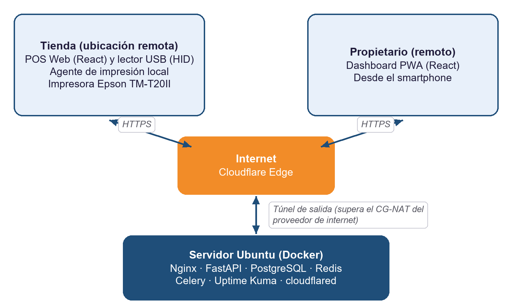
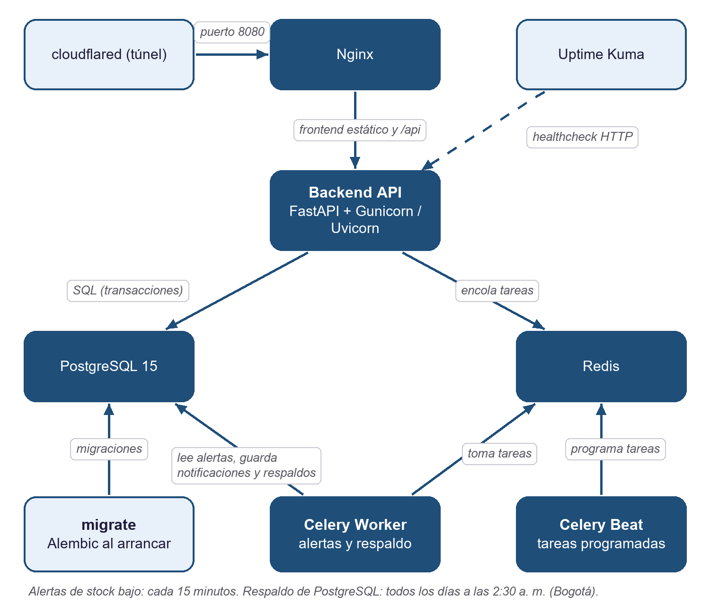
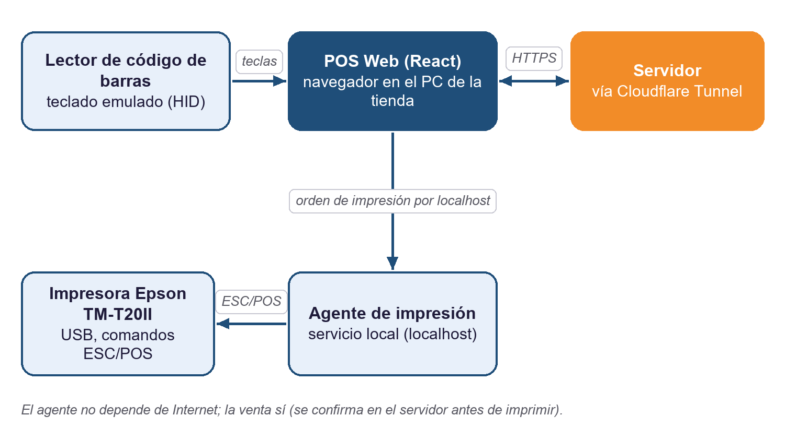
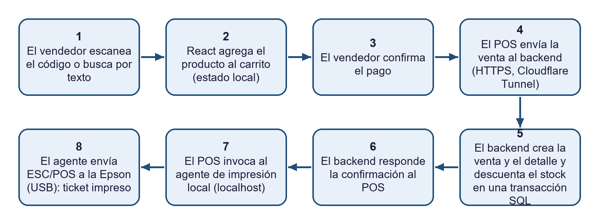
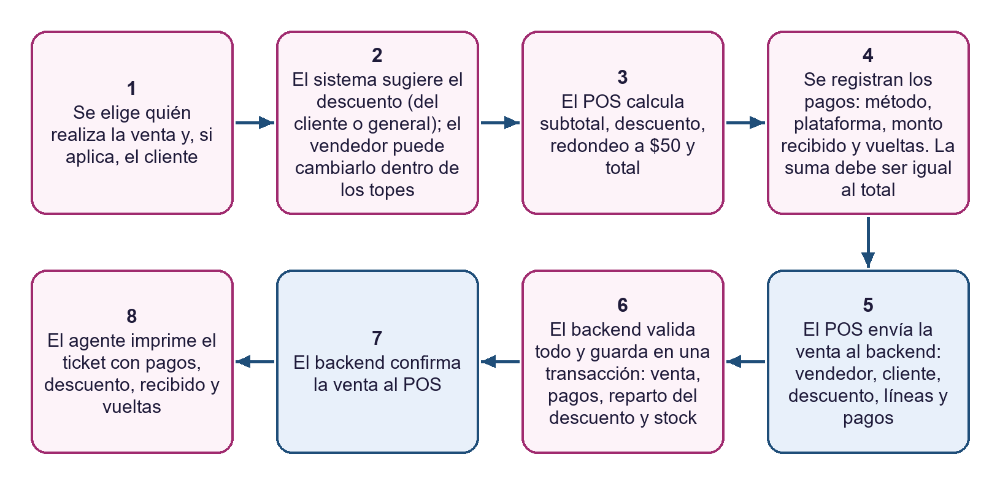
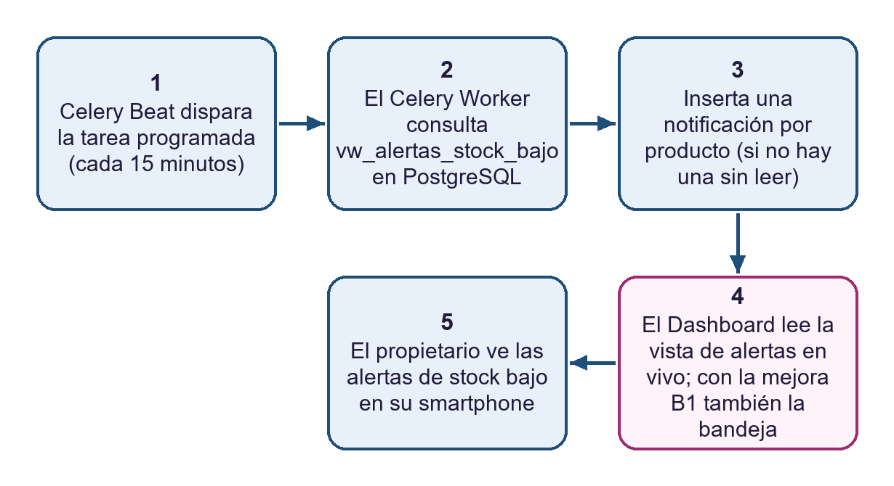

**PIÑATERÍA DEMO**

Sistema de Ventas e Inventarios

**Documento de Arquitectura Técnica**

Versión 1.11 (incluye Adendo v2, Fase 9 y Adendo v3)

2026

*Confidencial – Uso interno*

# 1. Introducción y Objetivo

Este documento describe la arquitectura técnica del Sistema de Ventas e Inventarios de Piñatería Demo: los componentes que lo conforman, cómo se comunican entre sí, dónde se despliegan físicamente y qué decisiones de diseño sustentan esas elecciones. Complementa al Plan de Trabajo v1.1, las Historias de Usuario v1.0 y el Diseño de Base de Datos v1.0, traduciendo esos requerimientos en una topología de infraestructura concreta.

A diferencia de un esquema on-premise tradicional, el servidor no está físicamente en la tienda: se aloja en un equipo propio del desarrollador. Esto significa que tanto el punto de venta (en la tienda) como el Dashboard del propietario son, desde la perspectiva de la red, clientes remotos que acceden al mismo servidor a través de Internet, usando Cloudflare Tunnel para atravesar el CG-NAT del proveedor residencial en el extremo del servidor.

Esta decisión tiene una implicación operativa importante: el punto de venta ahora depende de la conexión a Internet de la tienda para procesar cada transacción, ya que la base de datos y la lógica de negocio no residen localmente. La sección 10 (Riesgos y Mitigaciones) profundiza en cómo se gestiona esta dependencia.

**Versión 1.2.** Esta versión (a) deja el documento al día con lo implementado en las Fases 0 a 6 (servicios Docker, tareas programadas, seguridad y flujo de integración continua) y (b) incorpora el **Adendo v2**, una ampliación del alcance que no reemplaza nada de lo aprobado: pagos mixtos con vueltas, descuentos, clientes con Habeas Data, cambio de vendedor por venta y módulo de ganancias. El adendo no agrega contenedores ni servicios: cambia la API, la base de datos y el flujo de venta (secciones 5.1.1, 5.4 y 5.5).

# 2. Vista General de la Arquitectura

El siguiente diagrama resume los tres bloques principales y cómo se conectan: la tienda (POS, hardware y su agente de impresión local), el servidor Ubuntu alojado en un equipo propio con todos sus servicios en contenedores Docker, y el propietario, que accede al Dashboard desde su smartphone. Tanto la tienda como el propietario llegan al servidor por la misma vía: Internet, a través de Cloudflare Edge y un túnel saliente iniciado por el propio servidor.

*Figura 1. Vista general de la arquitectura — el servidor es remoto; tanto la tienda como el propietario son clientes remotos.*

El túnel de Cloudflare es indispensable en este esquema: como el servidor está bajo el proveedor residencial (CG-NAT), no tiene una IP pública propia ni puede recibir conexiones entrantes directas. El túnel abre una conexión saliente hacia el borde de Cloudflare, que luego enruta hacia el servidor tanto el tráfico del POS (ventas, catálogo) como el del Dashboard (solo lectura, restringido por RBAC al rol propietario).

# 3. Componentes y Responsabilidades

| Componente | Responsabilidad |
| :---- | :---- |
| POS Web (React) | SPA construida con React + Vite, servida como PWA instalable, ejecutada en el equipo de la tienda. Captura el teclado emulado del lector de código de barras (HID) y consume la API del backend remoto por HTTPS. |
| Agente de impresión local | Servicio ligero que corre en el mismo equipo de la tienda, escuchando en localhost. Recibe la orden de impresión desde el POS Web una vez el backend confirma la venta, y la traduce a comandos ESC/POS enviados por USB a la impresora. Es necesario porque el backend, al estar fuera de la tienda, no tiene acceso físico al puerto USB de la tienda. |
| Dashboard PWA (React) | Misma base tecnológica que el POS, con una vista de solo lectura para el rol propietario: ventas del día, alertas de stock y notificaciones. |
| Nginx | Reverse proxy dentro de Docker, en el servidor. Enruta las peticiones hacia el backend, sirve los archivos estáticos del frontend compilado y es el punto que Cloudflare Tunnel expone hacia Internet. |
| Backend API (FastAPI) | Expone la API REST, aplica las reglas de negocio (RBAC vía JWT, transacciones de venta/compra/ajuste) y es el único componente con acceso de escritura a PostgreSQL. Atiende tanto al POS de la tienda como al Dashboard del propietario, ambos como clientes remotos. |
| Gunicorn + Uvicorn workers | Servidor de aplicación que ejecuta el backend FastAPI dentro del contenedor, con varios workers Uvicorn gestionados por Gunicorn para aprovechar múltiples núcleos y tolerar fallos de un worker sin caer el servicio completo. |
| PostgreSQL 15 | Motor de base de datos relacional; almacena catálogo, transacciones, usuarios y notificaciones, según el Diseño de Base de Datos v1.2. |
| Redis | Broker de mensajería para Celery y almacenamiento de resultados de tareas asíncronas. |
| Celery Worker | Procesa tareas en segundo plano: generación de notificaciones de stock bajo, envío de correos/alertas y tareas de mantenimiento. |
| Celery Beat | Programador de tareas periódicas (implementado: revisión de stock bajo cada 15 minutos y respaldo diario de PostgreSQL a las 2:30 a. m. hora de Bogotá). |
| Uptime Kuma | Monitorea la disponibilidad del backend y de PostgreSQL mediante healthchecks HTTP/TCP y notifica caídas. |
| Cloudflare Tunnel | Cliente (cloudflared) que abre una conexión saliente desde el servidor hacia el borde de Cloudflare, evitando así la necesidad de abrir puertos entrantes o depender de una IP pública —inviable bajo el CG-NAT del proveedor residencial. Por este único túnel se enruta tanto el tráfico del POS como el del Dashboard. |
| Hardware POS | Lector de código de barras USB con emulación de teclado (HID) e impresora térmica Epson TM-T20II, ambos conectados al equipo de la tienda (no al servidor). |

# 4. Detalle de Componentes

## 4.1  Contenedores Docker (servidor)

Todos los servicios del servidor —salvo el propio sistema operativo Ubuntu— se ejecutan como contenedores orquestados con Docker Compose. El siguiente diagrama detalla cómo se comunican entre sí dentro de esa red interna.

*Figura 2. Comunicación entre contenedores dentro del servidor.*

**Servicios implementados (v1.2)**

| Servicio | Imagen / origen | Función | Exposición |
| :---- | :---- | :---- | :---- |
| db | postgres:15-alpine | Base de datos principal, con volumen nombrado. | Solo 127.0.0.1:5432 |
| redis | redis:7-alpine | Broker de Celery y resultados. | No se publica |
| migrate | imagen del backend | Aplica las migraciones de Alembic antes de arrancar el backend y termina (Exited 0). | No aplica |
| backend | imagen propia (FastAPI) | API REST con reglas de negocio y RBAC. | Solo dentro de la red Docker |
| celery_worker | imagen del backend | Ejecuta las tareas (respaldo y alertas). Monta ./backups. | No se publica |
| celery_beat | imagen del backend | Programa las tareas periódicas. | No se publica |
| nginx | nginx:alpine | Sirve el frontend compilado, enruta /api al backend y no expone /docs. | Puerto 8080, publicado solo en 127.0.0.1, tras el túnel |
| cloudflared | cloudflare/cloudflared | Túnel de salida hacia Cloudflare. | Sin puertos entrantes |
| uptime-kuma | louislam/uptime-kuma:1 | Monitoreo de disponibilidad. | Solo 127.0.0.1:3001 |

## 4.2  Equipo de la tienda (POS, hardware y agente de impresión)

Como el servidor ya no está físicamente junto a la impresora, la impresión requiere un componente adicional que sí vive en la tienda: el Agente de impresión local. El siguiente diagrama detalla ese flujo, independiente de la conexión al backend remoto.

*Figura 3. Componentes locales de la tienda y su interacción con el servidor remoto.*

El agente de impresión es un servicio pequeño y de una sola responsabilidad (recibir un ticket ya formado y enviarlo a la impresora), por lo que su disponibilidad no depende de Internet: seguirá funcionando aunque el enlace hacia el servidor esté caído, aunque en ese caso no podrá completarse la venta previa que lo dispara (ver sección 10, Riesgos y Mitigaciones).

# 5. Flujos de Datos Clave

## 5.1  Flujo de una venta (HU-01)

A diferencia de un esquema on-premise, aquí la venta sí depende de la conexión a Internet de la tienda: los pasos 1-3 y 7-8 ocurren localmente, pero los pasos 4-6 requieren ida y vuelta hasta el backend remoto a través de Cloudflare Tunnel.

*Figura 4. Flujo del proceso de venta, con el backend remoto.*

El paso 5 ocurre dentro de una única transacción de PostgreSQL (crear venta + detalle_ventas + descontar stock): si algo falla ahí, no se confirma nada y el POS no avanza al paso 6. La impresión (pasos 7-8), en cambio, ocurre después de que el backend ya confirmó la venta; si el agente de impresión local fallara, la venta ya quedó registrada y el ticket puede reimprimirse manualmente sin afectar la integridad de los datos.

### 5.1.1  Flujo de una venta con el Adendo v2

La Figura 4 muestra el flujo original. Con el Adendo v2 el contenido de la venta cambia, pero el principio es el mismo: todo ocurre en una única transacción y la impresión va después de la confirmación. Los pasos son:

1. El vendedor arma el carrito (lector o búsqueda manual) y, en el desplegable, confirma quién realiza la venta (RF-036; por defecto, el usuario de la sesión).

2. Opcionalmente asocia un cliente registrado y activo, con autorización vigente (RF-031).

3. El sistema sugiere el descuento propio del cliente, si lo tiene (RF-025, Fase A2). El descuento general no se aplica solo: el vendedor lo aplica a quien corresponda (RF-026). El vendedor puede cambiar o quitar el descuento o escribir uno manual (RF-027), dentro de los topes de porcentaje y de monto que configuró el administrador (RF-042).

4. El POS calcula el subtotal, el descuento sobre el subtotal y el total redondeado a múltiplo de $50 (RF-028).

5. El vendedor registra uno o más pagos con su método; en transferencia elige Nequi o Daviplata y en efectivo indica el monto recibido, y el POS muestra las vueltas (RF-022, RF-023, RF-024). El POS no permite confirmar si la suma de los pagos no es igual al total.

6. El POS envía la venta al backend: vendedor, cliente, descuento, líneas y pagos.

7. El backend, dentro de una única transacción de PostgreSQL, vuelve a calcular y valida todo (descuento y sus topes, redondeo, suma de pagos, vendedor activo, cliente válido), guarda la venta con sus pagos, reparte el descuento entre las líneas, guarda el costo vigente de cada producto (Fase A3) y descuenta el stock. Si algo falla, no se confirma nada.

8. Con la venta confirmada, el POS envía al agente de impresión el ticket con los pagos, el descuento, el recibido y las vueltas.

*Figura 4b. Flujo de una venta con el Adendo v2 (en magenta, los pasos que cambian o se agregan).*

El cálculo del frontend es solo informativo: el backend es quien decide los montos, para que ninguna venta quede con un total inconsistente.

## 5.2  Flujo de alertas de stock bajo (HU-03)

Las alertas no se calculan bajo demanda cada vez que el propietario abre el Dashboard, sino que se generan de forma proactiva en segundo plano:

*Figura 5. Flujo de generación de alertas de stock bajo.*

Antes de insertar una nueva fila en notificaciones, el worker verifica que no exista ya una alerta reciente sin leer para el mismo producto, evitando saturar el Dashboard con duplicados si el stock permanece bajo durante varios ciclos consecutivos.

### 5.2.1  Bandeja de notificaciones y lista de compras (Adendo v2, mejora B1)

Hasta ahora la tarea de Celery guarda las alertas en la tabla notificaciones pero ninguna pantalla las muestra; el Dashboard lee en vivo la vista vw_alertas_stock_bajo. La mejora B1 aprovecha ese mismo mecanismo sin cambiar el esquema:

1. El Dashboard pide al backend las notificaciones (GET /notificaciones) y muestra la bandeja con el contador de no leídas. El usuario puede marcar una o todas como leídas (PATCH), lo que solo actualiza la columna leida.

2. Al abrir la lista de compras, el backend (GET /dashboard/lista-compras) consulta la vista de alertas y devuelve cada producto con su stock, su mínimo y la cantidad faltante; no depende de las notificaciones, de modo que la lista nunca queda desactualizada.

3. El frontend arma el texto del mensaje y abre un enlace wa.me para que el usuario lo envíe por WhatsApp, o lo copia al portapapeles. No hay llamadas a servicios externos desde el servidor.

Todos los endpoints validan el rol en el JWT (propietario y administrador; el vendedor recibe 403).

## 5.3  Flujo de autenticación y control de acceso

Todas las peticiones a la API (salvo el login) requieren un token JWT válido, emitido al autenticarse con usuario y contraseña:

* El backend valida las credenciales contra la tabla usuarios (contraseña almacenada como hash, nunca en texto plano).

* Si son correctas, emite un JWT firmado que incluye el id de usuario y su rol (administrador, vendedor o propietario).

* Cada endpoint sensible valida el rol contenido en el JWT mediante Dependency Injection de FastAPI antes de ejecutar la lógica de negocio (ej. el módulo de proveedores solo admite el rol administrador, según HU-04).

* Un intento de acceso sin token válido o con un rol insuficiente responde 401 Unauthorized o 403 Forbidden, respectivamente.

## 5.4  Flujo de registro de clientes y Habeas Data (Adendo v2, Fase A2)

1. El empleado abre el alta de cliente; el POS muestra el aviso de privacidad con la finalidad del tratamiento, los derechos del titular y el canal de atención.

2. El empleado captura nombre, documento, teléfono y correo, elige el medio por el que el cliente autoriza (escrito, electrónico o verbal) y marca la autorización. Sin ella el backend rechaza el alta.

3. El backend guarda el cliente con la evidencia: fecha, medio, versión de la política y empleado.

4. Si el titular presenta una consulta o un reclamo, el administrador lo registra en solicitudes_titular; el sistema calcula la fecha límite según el plazo legal. Al resolver una supresión, el backend anonimiza el registro del cliente y conserva sus ventas sin datos que lo identifiquen.

5. La revocatoria de la autorización impide asociar al cliente a ventas nuevas.

Los detalles legales y los documentos que debe tener el negocio están en el Documento de Visión, Anexo A.

**Estado implementado (12-10-2026, Fase A2).** Routers `clientes` (vendedor y administrador; el descuento propio, solo administrador) y `solicitudes_titular` (solo administrador); el cálculo de plazos y la anonimización viven en `services/habeas_data.py`. En el alta, el cliente marca la autorización y elige el medio; el servidor registra la fecha, la versión de la política (`POLITICA_DATOS_VERSION`) y el empleado. El POS muestra el aviso de privacidad y la política completa (el texto aprobado vive en `services/politica_datos.py`; los datos del negocio los edita el administrador en la aplicación y se guardan en `configuracion_negocio`) y una casilla aparte, desmarcada, para promociones. `GET /ventas/vendedores` alimenta el desplegable de vendedor y `POST /ventas` valida `cliente_id` y `vendedor_id`; el ticket al agente de impresión lleva solo el nombre del vendedor, nunca datos del cliente.

### 5.4.1  Autorregistro del cliente por enlace público (Adendo v2, Fase A2)

Además del alta hecha por un empleado, el cliente puede registrarse solo:

1. El administrador copia el enlace de autorregistro (que contiene un código aleatorio guardado en enlace_autoregistro) y lo comparte por WhatsApp o lo muestra en la tienda.

2. El cliente abre el enlace en su celular. La página es una ruta pública del frontend: no pide inicio de sesión. Muestra el aviso de privacidad y la política vigente y un formulario con nombre, documento, teléfono y correo.

3. El envío solo se habilita al marcar la aceptación. El navegador llama a un endpoint público del backend con el código del enlace.

4. El backend valida el código y que el enlace esté activo, aplica el límite de envíos, descarta los envíos que llenen el campo trampa y guarda al cliente con origen autoregistro, medio electrónico, fecha y versión de la política. No guarda la dirección IP. Si el documento o el teléfono ya existen, responde con un mensaje neutro sin revelar ni modificar nada.

5. El cliente queda activo y sin descuento propio; desde ese momento un empleado puede buscarlo y asociarlo a una venta.

**Estado (12-10-2026): implementado.** El administrador administra el enlace con `/autoregistro/enlace`; la página pública es la ruta `/registro/<código>` del frontend (no pasa por el login) y usa `GET` y `POST /publico/autoregistro/{código}`. El límite de envíos está en dos capas: Nginx (`limit_req` por visitante, usando `Cf-Connecting-Ip` que pone Cloudflare, 6 por minuto) y el backend (5 envíos cada 10 minutos, en memoria y con la dirección convertida en hash). No se guarda la IP.

Este es el único endpoint de la API que no exige JWT. Por eso Nginx limita la tasa de peticiones a su ruta (limit_req) además del límite del backend, y el enlace se puede desactivar o regenerar en cualquier momento. Requiere una dirección estable, es decir, el dominio propio con Named Tunnel.

## 5.5  Flujo del módulo de ganancias (Adendo v2, Fase A3)

1. El administrador registra a mano el costo de cada producto; para una ancheta, el sistema muestra un costo sugerido (suma de los costos de sus componentes) que también se puede ajustar.

2. Al confirmar una venta, el backend guarda en cada línea el costo vigente del producto, de modo que cambios posteriores del costo no alteran el margen histórico.

3. El dashboard de ganancias consulta la vista vw_margen_detalle (ingreso neto menos costo) agrupada por producto y por periodo. Las líneas sin costo se excluyen y se informan aparte.

4. Todos los endpoints de costos y ganancias validan el rol en el JWT: solo administrador y propietario; el vendedor recibe 403 (RF-040).

5. Endpoints implementados: GET /costos (tabla de costos con el sugerido), PATCH /productos/{id}/costo y POST /costos/completar-ventas (solo administrador; el segundo llena con el costo actual solo las líneas de ventas pasadas sin costo) y GET /ganancias (resumen, por día y por producto, y líneas sin costo). El administrador los usa desde la pestaña "Ganancias" del punto de venta; el propietario, desde su Dashboard.

## 5.6  Flujo de una venta sin conexión (Fase 9)

1. Mientras hay conexión, el POS guarda en el equipo (IndexedDB) los productos activos (sin costos), el descuento general con sus topes y la lista de vendedores. Los refresca al abrir, al volver la conexión y cada 10 minutos.

2. El POS decide que no hay conexión cuando el navegador lo avisa o cuando una petición falla por red, se agota (12 s al confirmar una venta) o responde 502, 503, 504 o un 52x de Cloudflare. Mientras no hay conexión o quedan ventas por enviar consulta `/health` cada 20 segundos, porque `navigator.onLine` no detecta un túnel o un servidor caídos.

3. Cada venta se confirma con un `uuid_cliente`. Con conexión viaja a `POST /ventas` como siempre. Sin conexión, o si el servidor no responde, la venta se guarda en la cola local (payload completo, hora real, precios y descuento que vio el cliente) y el ticket se imprime por el agente local con un número `SC-####`.

4. Al volver la conexión, el sincronizador envía las ventas de la más antigua a la más reciente. El servidor valida igual que una venta normal (stock, pagos, topes, vendedor) y responde 201; si ya tenía la venta responde 200 sin tocar el stock (índice único sobre `uuid_cliente`).

5. Un fallo de conexión detiene el envío y se reintenta; un 401 pide iniciar sesión (la cola se conserva); cualquier otro rechazo (409, 422…) deja la venta como "Necesita revisión" con el motivo, sin frenar a las demás. Una persona la resuelve (por ejemplo, registrando el stock que faltaba) y la reintenta, o la descarta confirmando.

6. Un vendedor envía solo las ventas que guardó él; un administrador envía las de todos.

La venta sin conexión conserva `ventas.fecha` (la hora de la tienda) y se marca con `sin_conexion` y `sincronizada_en`. No se guardan datos de clientes en el equipo. Detalle completo en el documento 11.

## 5.7  Flujo de gastos y corte de caja (Adendo v3)

Diseñado el 19-10-2026 e implementado en las fases G1 (19-10-2026), G2 y G3 (20-10-2026); detalle en el documento 12.

1. **Gastos.** El POS (administrador y vendedor) envía el gasto a `POST /gastos`. El backend valida el rol en el JWT, que el monto sea entero (múltiplo de $50 si es en efectivo), la plataforma si es transferencia y la categoría activa; fija `registrado_por_id` con el usuario del token y la fecha de hoy si el usuario es vendedor. Los nombres y las descripciones se normalizan como el resto (RF-058).

2. **Permisos por dueño.** Para listar, editar y anular, el servidor aplica el filtro `registrado_por_id = usuario` al vendedor y rechaza (403 o 404) cualquier otra fila; el propietario solo tiene GET; el administrador no tiene filtro. La interfaz oculta botones, pero no es la barrera: lo es el servidor.

3. **Anular.** `POST /gastos/{id}/anular` exige `motivo`, llena `anulado_*` y no borra nada. Los totales excluyen lo anulado.

4. **Compras unificadas.** La recepción de una compra (existente) pasa a recibir su forma de pago y guarda `recibida_en`. La vista `vw_gastos_unificados` une gastos y compras recibidas; solo el administrador y el propietario la consultan.

5. **Ganancia neta (G3).** `GET /ganancias` suma a su respuesta los gastos operativos del rango (sin la categoría de sistema) y calcula la ganancia neta y el resultado de caja; usa los mismos rangos y la misma zona horaria (America/Bogota) que el resto del Dashboard.

6. **Caja (G2).** `POST /caja/abrir` crea el corte (el índice único parcial impide dos abiertos). `GET /caja/actual` calcula el efectivo esperado en vivo con consultas sobre `pagos_venta`, `gastos`, `compras` y `movimientos_caja` del período. `POST /caja/cerrar` recalcula dentro de una transacción, guarda la foto y cambia el estado a cerrada; un segundo cierre responde con error.

7. **Sin conexión.** Los gastos y la caja no pasan por IndexedDB ni por el sincronizador de ventas: sin conexión sus pantallas avisan. Para que el corte no quede desfasado, el POS consulta su cola de ventas antes de cerrar la caja y no deja cerrarla mientras haya ventas guardadas sin enviar; las ventas sin conexión que lleguen después del cierre no cambian la foto del corte (la ficha las muestra como aviso).

8. **Exportar.** `GET /gastos/exportar` y `GET /caja/cortes/exportar` generan en el backend un CSV UTF-8 con BOM y punto y coma, con los mismos filtros que la lista.

**Decisiones técnicas del Adendo v3**

| Decisión | Razón |
| :---- | :---- |
| Foto del corte al cerrar, en lugar de recalcular siempre | Un corte cerrado es un registro de control: no debe cambiar si después se anula un gasto o llega una venta sin conexión. |
| La caja usa `creado_en` y la ganancia usa `fecha` | Un gasto con fecha anterior (arriendo pagado ayer) sale del efectivo de hoy, pero pertenece al día que el administrador eligió en los informes. |
| La ganancia neta no resta las compras de mercancía | El costo de lo comprado ya entra en el margen cuando se vende; restarlo también al comprar lo contaría dos veces. El resultado de caja muestra aparte el flujo con todos los gastos. |
| El vendedor consulta `gastos` filtrada y no la vista unificada | La vista incluye compras y proveedores, que el vendedor no puede ver (RF-021). |
| Una sola caja abierta con índice único parcial | La base impide el estado inválido aunque dos personas pulsen "Abrir caja" a la vez. |
| La caja usa el reloj de la base de datos | La apertura, el cierre, `ventas.fecha`, `gastos.creado_en` y `compras.recibida_en` salen del mismo `now()` de Postgres; así el período de un corte los incluye sin diferencias de reloj entre la aplicación y la base. |

# 6. Infraestructura y Despliegue

**Entorno base (servidor)**

* Sistema operativo: Ubuntu Server (LTS), instalado en un equipo físico propio, bajo conexión residencial.

* Orquestación: Docker + Docker Compose, con un archivo docker-compose.yml versionado en el repositorio Git.

* Cada servicio (nginx, backend, postgres, redis, worker, beat, uptime-kuma, cloudflared) corre en su propio contenedor, dentro de una red Docker interna dedicada al proyecto.

**Entorno de la tienda**

* Un equipo (PC o tablet) con navegador en modo kiosco ejecuta el POS Web; no requiere Docker ni instalación de servidor alguno.

* El Agente de impresión local corre como proceso/servicio del sistema operativo de ese mismo equipo (inicio automático al encender), escuchando solo en localhost.

* Requisito de conectividad: la tienda necesita una conexión a Internet estable, ya que toda operación de venta depende de llegar al backend remoto.

**Persistencia y datos**

* El volumen de datos de PostgreSQL se monta en un volumen Docker nombrado, para que los datos sobrevivan a la recreación de contenedores.

* Los respaldos (.dump de pg_dump, según el DoD del Plan de Trabajo) se generan mediante una tarea programada de Celery Beat y se almacenan fuera del contenedor, en el sistema de archivos del host.

**Exposición y red**

* Nginx escucha en el puerto **8080** y se publica solo en `127.0.0.1` del servidor (no en toda la red); antes usaba el 80 abierto en todas las interfaces. El único camino de entrada queda siendo el túnel de Cloudflare, que llega a Nginx por la red interna de Docker (`http://nginx:8080`). Cambiar solo el número de puerto no protege; lo que protege es dejar de exponerlo fuera del servidor. Aplicado en `docker-compose.yml`, `nginx/nginx.conf` y `DEPLOY.md`. Al desplegar hay que cambiar también el *Service* del túnel en Cloudflare (ver "Cambio del puerto de Nginx" en `DEPLOY.md`).

* Cloudflare Tunnel es, en este esquema, el único camino de entrada al servidor: expone hacia Internet tanto las rutas del POS (ventas, catálogo) como las del Dashboard del propietario, mediante una conexión saliente cifrada que resuelve la limitación de CG-NAT del proveedor residencial sin abrir puertos entrantes en el router del servidor.

* Al no existir ya una red LAN compartida entre POS y backend, todo el tráfico de la aplicación viaja por Internet — de ahí que HTTPS extremo a extremo y la autenticación JWT dejen de ser una capa opcional y pasen a ser el único control de acceso al sistema.

**Integración y despliegue continuos (actualización v1.2)**

* **Flujo de ramas:** rama de trabajo → pull request → dev → pull request → main, con fusión mediante merge commit. No se permite empujar directamente a main (hay un hook local y la protección del repositorio). Staging se despliega con la rama dev y producción con main, cuando el propietario aprueba.

* **Integración continua (CI), implementada:** GitHub Actions ejecuta en cada pull request tres trabajos —Backend (pytest sobre una base PostgreSQL de prueba), Agente de impresión (pytest) y Frontend (pruebas y compilación)— y deben estar en verde para fusionar.

* **Despliegue continuo (CD), implementado en la Fase 7:** un workflow de GitHub Actions (`despliegue.yml`) que, con cada push a la rama que sigue el servidor (dev en staging, main en producción) y solo si el CI de ese commit está en verde, se ejecuta en un runner self-hosted del servidor: respaldo previo por Celery, avance de la rama solo hacia adelante, compilación del frontend si cambió, `docker compose up -d --build`, espera de la migración y comprobación de `/api/health`. Nunca se dispara con pull requests, no lee el .env, corre un despliegue a la vez y, si algo falla, muestra el estado y se detiene sin restaurar ni revertir nada. Una migración nueva exige una aprobación manual previa (variable `MIGRACIONES_APROBADAS`). El runner con acceso a Docker equivale a acceso de administrador al servidor, riesgo que se acepta porque el repositorio es privado y no se despliega código de pull requests. Tras levantar los servicios se recarga Nginx (conserva la IP del backend resuelta al arrancar) y el frontend se compila en una carpeta temporal antes de reemplazar la que sirve Nginx. El hook local `pre-push` bloquea el push directo a `main` y `dev`, porque un push a la rama del servidor lo despliega; sin GitHub Pro no hay protección de ramas en GitHub. Detalle y operación en DEPLOY.md, sección 7.

**Dominio propio (actualización v1.2)**

* El sistema se publica con un Named Tunnel de Cloudflare (`pinateria-demo-server`) en el dominio propio `demo.example.com`: `pos.demo.example.com` apunta a http://nginx:8080. La variable AGENTE_ORIGENES_PERMITIDOS del agente de impresión debe incluir ese dominio. El servidor no debe tener un docker-compose.override.yml con el túnel temporal que se usó antes.

**Variables de entorno y secretos**

* Credenciales de base de datos, la clave de firma de JWT y el token de Cloudflare Tunnel se gestionan mediante un archivo .env excluido del control de versiones (.gitignore), nunca hardcodeados en el código.

# 7. Seguridad

* **Autenticación y autorización:** JWT + RBAC en el backend, con tres roles (administrador, vendedor, propietario) validados en cada endpoint sensible.

* **Cifrado en tránsito:** Cloudflare gestiona el certificado TLS del acceso remoto; el tráfico dentro de la LAN de la tienda es de menor riesgo por no salir del local, aunque se recomienda habilitar TLS también en Nginx a mediano plazo.

* **Contraseñas:** se almacenan únicamente como hash (ej. bcrypt/argon2) en usuarios.password_hash; nunca en texto plano ni en logs.

* **Datos sensibles de proveedores:** protegidos a nivel de aplicación (RBAC), no solo ocultos en la interfaz — el backend rechaza con 403 cualquier intento directo a /api/v1/suppliers desde un rol distinto de administrador (HU-04).

* **Secretos:** gestionados vía variables de entorno, fuera del control de versiones.

* **Superficie de ataque:** al no abrir puertos entrantes en el router del servidor (gracias a Cloudflare Tunnel), se reduce significativamente la exposición directa del servidor a Internet.

* **Implementado (v1.2):** el token JWT dura 8 horas; las contraseñas se guardan con bcrypt; la documentación interactiva de la API (/docs) no se expone públicamente; PostgreSQL y Uptime Kuma solo escuchan en 127.0.0.1 y Redis no se publica.

* **Adendo v2 — costos y ganancias:** los endpoints de costos y ganancias solo admiten administrador y propietario; el costo no se incluye en ninguna respuesta que vea el vendedor (RF-040).

* **Adendo v2 — datos personales de clientes:** acceso por roles (el vendedor registra y consulta clientes; el administrador asigna descuentos y atiende solicitudes), evidencia de la autorización, anonimización a solicitud y carpeta de respaldos con acceso restringido, porque los respaldos contienen datos de clientes. Se debe revisar jurídicamente el paso del tráfico por Cloudflare, un tercero con infraestructura fuera de Colombia (Visión, Anexo A.6).

* **Adendo v2 — endpoint público de autorregistro:** es la única ruta sin JWT, por lo que se protege con un código aleatorio en el enlace (regenerable por el administrador), límite de envíos en Nginx y en el backend, campo trampa, respuestas neutras que no revelan clientes existentes y sin almacenar la dirección IP.

* **Tráfico POS ↔ backend:** al viajar siempre por Internet (y no por una LAN de confianza), cada petición del POS se autentica y autoriza igual que las del Dashboard; no existe una ruta "interna" con reglas más laxas.

# 8. Monitoreo y Respaldo

Ambos mecanismos están definidos como parte de la Definición de "Terminado" (DoD) del Plan de Trabajo v1.1 y se implementan así:

* **Uptime Kuma** supervisa el backend (healthcheck HTTP sobre un endpoint /health) y PostgreSQL (healthcheck TCP), con notificaciones configurables ante caídas.

* **Respaldo automático** de PostgreSQL mediante pg_dump, ejecutado por una tarea programada de Celery Beat; el archivo .dump resultante se conserva en el host (carpeta ./backups) con una retención de 14 días. Implementado: se ejecuta todos los días a las 2:30 a. m. (hora de Bogotá), cada respaldo se verifica con pg_restore --list antes de darlo por bueno y un respaldo fallido nunca borra los anteriores; el error queda en los registros del worker.

* **Adendo v2:** antes de aplicar en producción una migración que transforma datos (la 0002, que migra los métodos de pago) se genera un respaldo manual y la migración se ensaya primero en staging con una copia de la base.

* **Verificación periódica** de que el respaldo más reciente exista y tenga un tamaño razonable, como parte de la revisión quincenal con el propietario.

# 9. Riesgos y Mitigaciones

Alojar el servidor fuera de la tienda, separado físicamente de la tienda, introduce dependencias de red que no existían en un esquema on-premise. Esta sección documenta esas dependencias y cómo se mitigan:

| Riesgo | Impacto | Mitigación |
| :---- | :---- | :---- |
| Caída de Internet en la tienda | Sin la Fase 9, el POS no podía crear ventas ni consultar el catálogo. | **Mitigado en la Fase 9:** el POS sigue vendiendo con una copia del catálogo guardada en el equipo y envía las ventas al volver la conexión (sección 5.6). Límites: sin conexión no se puede iniciar sesión (no cerrar sesión durante el corte), no hay clientes, historial ni inventario, y el stock mostrado puede estar desactualizado. El router 4G de respaldo sigue siendo recomendable. |
| Caída de Internet del servidor | Ni la tienda ni el propietario pueden acceder al sistema, incluyendo el Dashboard. | Uptime Kuma notifica la caída; el proveedor residencial es residencial, por lo que se recomienda evaluar a futuro un enlace secundario o un proveedor con mejor SLA si el negocio crece. |
| Latencia percibida en el POS | Cada venta ahora implica un viaje de ida y vuelta al servidor en vez de tráfico LAN local, lo que podría acercar el proceso al límite de 2 segundos definido en HU-01. | Cloudflare Edge reduce la latencia al enrutar por el punto más cercano; se recomienda validar los tiempos reales en Fase 6 (Integración y Pruebas) y ajustar si es necesario. |
| Agente de impresión local fuera de línea | Si el servicio de impresión se detiene en el equipo de la tienda, la venta se registra en el backend pero el ticket no se imprime. | El agente debe configurarse con inicio automático y reinicio ante fallos (ej. como servicio systemd o tarea programada); el vendedor puede reimprimir manualmente desde el historial de ventas del POS. |

**Riesgos del Adendo v2**

| Riesgo | Impacto | Mitigación |
| :---- | :---- | :---- |
| La migración 0002 transforma las ventas existentes (pagos y subtotales) y puede dejar datos inconsistentes. | Alto: afecta el historial y el dashboard. | Respaldo previo, ensayo en staging con copia de producción y pruebas que verifican que la suma de pagos de cada venta iguala su total. |
| Los datos personales de los clientes se tratan sin cumplir la Ley 1581 de 2012. | Alto: riesgo legal y reputacional. | Autorización obligatoria con evidencia, registro de solicitudes con plazos, anonimización, roles y documentos de política y aviso (Visión, Anexo A). |
| El formulario público de autorregistro es objeto de spam o de intentos de descubrir clientes existentes. | Medio. | Código aleatorio regenerable, límite de envíos en Nginx y backend, campo trampa y respuestas neutras. |
| La venta con varios pagos y descuentos puede acercarse al límite de 2 segundos. | Medio. | El cálculo es en memoria y la transacción solo agrega filas; se verifica con la prueba de carga de 4 usuarios concurrentes. |
| El margen de ganancias queda incompleto por productos sin costo. | Medio. | Se informan como "sin costo" y se excluyen del margen. |

# 10. Decisiones Técnicas y Alternativas Consideradas

| Decisión | Justificación |
| :---- | :---- |
| Servidor remoto vs. on-premise en la tienda | El desarrollador ya cuenta con infraestructura propia, evitando el costo de un equipo dedicado en la tienda y facilitando el mantenimiento directo. El costo operativo es la nueva dependencia de Internet en la tienda para cada venta (ver sección 9). |
| Servidor propio vs. nube pública (AWS/GCP) | Se descartó una nube pública por el costo recurrente injustificado para el volumen de la tienda; el servidor que ya tiene el desarrollador cumple el mismo rol sin gasto adicional. |
| Cloudflare Tunnel vs. port-forwarding / IP fija | El proveedor residencial asigna IP bajo CG-NAT, lo que impide el port-forwarding tradicional. Cloudflare Tunnel resuelve esto con una conexión saliente, sin costo adicional y sin depender de una IP pública fija, exponiendo tanto el POS como el Dashboard. |
| Agente de impresión local vs. impresión desde el backend | Al no estar el servidor físicamente junto a la impresora, la impresión no puede resolverse con acceso directo al USB desde el backend. Un agente local pequeño en la tienda resuelve esto sin exigirle al navegador permisos avanzados de hardware (WebUSB tiene soporte limitado). |
| FastAPI vs. Django | Se eligió FastAPI por su bajo overhead, tipado nativo con Pydantic (menos errores en un proyecto de un solo desarrollador) y soporte async nativo, adecuado para las tareas en segundo plano vía Celery. |
| PostgreSQL vs. MySQL/SQLite | PostgreSQL ofrece tipos ENUM nativos, índices parciales (necesarios para codigo_barras opcional) y la extensión pg_trgm para búsqueda parcial de texto, todos usados explícitamente en el Diseño de Base de Datos v1.0. |
| React (PWA) vs. aplicación nativa | Una PWA evita la fricción de instalar apps nativas y permite reutilizar el mismo código base entre el POS y el Dashboard, con Service Workers para caché de interfaz. |
| Pagos en una tabla pagos_venta vs. columnas en ventas | Una venta puede tener varios pagos de distinto método. Una tabla hija con una fila por pago escala sin cambiar el esquema (más métodos o más pagos), permite sumar por método en el dashboard y deja una sola fuente de verdad: por eso ventas.metodo_pago se elimina y se migra. (Adendo v2) |
| Anonimizar al suprimir vs. borrar al cliente | Las ventas son registro contable y no pueden desaparecer; anonimizar el cliente cumple la supresión de datos personales y conserva la integridad del historial. (Adendo v2) |
| Cola de ventas en IndexedDB vs. Service Worker | Las ventas son datos de la aplicación, no archivos de la interfaz. El Service Worker sigue guardando solo la interfaz (para que la aplicación abra sin internet) y nunca respuestas de la API. IndexedDB es transaccional, sobrevive a reiniciar el equipo y no necesita librerías. (Fase 9) |
| Identificador por venta (`uuid_cliente`) en todas las ventas | Si se pierde la respuesta de una venta, el POS no sabe si el servidor la registró. Reenviarla con el mismo identificador es seguro: el índice único evita el duplicado. (Fase 9) |
| Conflictos al enviar: los resuelve una persona | La venta ya ocurrió (el cliente pagó y se llevó el producto). Forzar stock negativo o descartarla en silencio sería peor; queda visible con el motivo y se reintenta tras corregir la causa. (Fase 9) |
| Sin clientes en el equipo | Evita guardar datos personales en el navegador (Habeas Data). Sin conexión la venta no lleva cliente. (Fase 9) |
| Guardar el costo en cada línea de venta vs. leerlo del producto | Si solo se leyera del producto, el margen de ventas pasadas cambiaría cada vez que cambie el costo. La copia en detalle_ventas hace el margen histórico inmutable. (Adendo v2, Fase A3) |
| Enlace público con código aleatorio vs. formulario abierto o con inicio de sesión | El cliente no tiene cuenta, así que no se puede exigir sesión. Un código aleatorio que el administrador puede regenerar evita que cualquiera adivine la dirección y permite cortar el acceso si el enlace se difunde mal. (Adendo v2, Fase A2) |
| Mensaje de WhatsApp prellenado (enlace wa.me) para la lista de compras | El enlace abre WhatsApp con el mensaje ya escrito y el propio usuario elige el chat y lo envía: no requiere cuentas adicionales ni costos y funciona en celular y computador. Como la bandeja lee la tabla notificaciones, más adelante se pueden agregar otros canales (correo o push) sin cambiar cómo se generan las alertas. (Adendo v2, mejora B1) |
| Nginx en el puerto 8080 y solo en 127.0.0.1 vs. puerto 80 abierto en la red | El puerto 80 se publicaba en todas las interfaces del servidor, aunque la tienda no accede por la red local (el servidor es remoto). Como todo el tráfico entra por el túnel, publicar Nginx solo en 127.0.0.1 elimina una superficie de ataque; usar 8080 además evita el puerto privilegiado. Cambiar únicamente el número sería seguridad por oscuridad y no basta. (Adendo v2, Fase 7) |
| Docker Compose vs. despliegue directo en el host | Contenedores aíslan las versiones de cada servicio (Postgres, Redis, etc.) y simplifican tanto el entorno de staging como la recuperación ante fallos, sin la complejidad operativa de un orquestador mayor (Kubernetes) que no se justifica para un solo servidor. |

# Control de Versiones

| Versión | Fecha | Autor | Cambios |
| :---- | :---- | :---- | :---- |
| 1.0 | 2026 | Santiago Chávez López | Versión inicial de la arquitectura técnica. |
| 1.1 | 2026 | Santiago Chávez López | Servidor remoto, agente de impresión local, riesgos y mitigaciones. |
| 1.2 | 01-10-2026 | Santiago Chávez López | **Adendo v2:** flujo de venta con pagos mixtos, descuentos, cliente y vendedor (5.1.1), flujos de clientes con Habeas Data y autorregistro (5.4 y 5.4.1), de ganancias (5.5) y de la bandeja de notificaciones con lista de compras (5.2.1), seguridad de costos y datos personales, riesgos y decisiones del adendo. Actualización con el estado implementado: servicios Docker, tareas programadas, valores del respaldo, seguridad, integración continua y plan de dominio propio y despliegue continuo. |
| 1.3 | 08-10-2026 | Santiago Chávez López | **Adendo v2 (Fase A1):** en el flujo de venta (5.1.1), el descuento general deja de sugerirse en todas las ventas: el vendedor lo aplica a quien corresponda. |
| 1.4 | 08-10-2026 | Santiago Chávez López | **Adendo v2 (Fase A3):** flujo de ganancias (5.5) con los endpoints implementados, el completado del costo de ventas pasadas y dónde lo ven el administrador y el propietario. |
| 1.5 | 12-10-2026 | Santiago Chávez López | **Fase 7:** despliegue continuo implementado (workflow de GitHub Actions con runner self-hosted, aprobación manual de migraciones y reglas de seguridad) y dominio propio con Named Tunnel ya en uso. |
| 1.6 | 12-10-2026 | Santiago Chávez López | Despliegue continuo verificado en el servidor (recarga de Nginx y compilación del frontend en carpeta temporal), hook local contra el push directo a `dev`, Dependabot hacia `dev` y migración del frontend a Vite 8 y Vitest 5. |
| 1.7 | 12-10-2026 | Santiago Chávez López | **Adendo v2 (Fase A2):** estado implementado de los clientes con Habeas Data, las solicitudes de titulares, el vendedor por venta, la política y las promociones aparte (5.4) y el autorregistro por enlace con su doble límite de envíos (5.4.1). |
| 1.8 | 13-10-2026 | Santiago Chávez López | **Adendo v2 (Fase A2):** los datos del negocio de la política de datos se guardan en la tabla `configuracion_negocio` y el administrador los edita en la aplicación (5.4). |
| 1.9 | 14-10-2026 | Santiago Chávez López | **Fase 9:** flujo de venta sin conexión (5.6), riesgo de caída de internet en la tienda mitigado (9) y decisiones técnicas del modo sin conexión (10). |
| 1.10 | 19-10-2026 | Santiago Chávez López | **Adendo v3 (gastos y corte de caja):** flujo planeado de gastos, permisos por dueño, compras unificadas, ganancia neta, caja y corte, exportación y su relación con el modo sin conexión (5.7), con sus decisiones técnicas. Sin código. |
| 1.11 | 20-10-2026 | Santiago Chávez López | **Adendo v3 (G1 a G3):** el flujo 5.7 pasa de planeado a implementado y se agrega la decisión del reloj de la caja. |
