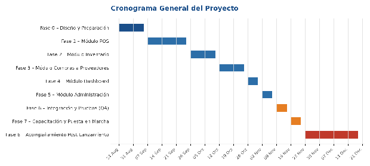

**PIÑATERÍA DEMO**

Sistema de Ventas e Inventarios

**Plan de Trabajo y Cronograma**

Versión 1.10 (incluye Adendo v2, Fase 9 y Adendo v3)

2026

*Confidencial – Uso interno*

# 1. Introducción

## 1.1 Objetivo del documento

Este Plan de Trabajo define la metodología, las fases, el cronograma y los criterios de control para el desarrollo del Sistema de Ventas e Inventarios de Piñatería Demo, a partir de lo definido en el Documento de Visión y Alcance (versión vigente: 1.4).

## 1.2 Alcance del plan

El plan cubre desde el diseño técnico detallado hasta la puesta en marcha y el acompañamiento posterior al lanzamiento, incluyendo los ajustes acordados con el cliente: catálogo abierto a más de 150 productos, impresión de factura en la impresora térmica Epson TM-T20II, lectura de código de barras en el punto de venta, y restricción del acceso al directorio de proveedores exclusivamente al rol Administrador.

Acuerdo de diseño de códigos de barras (Cerrado en Fase 0): Se definió un modelo mixto. El campo codigo_barras en la base de datos de PostgreSQL será opcional (permitirá nulos). El sistema no generará ni imprimirá códigos de barras internos. Los productos sin código se gestionarán mediante el buscador manual del POS.

**Adendo v2 (versión 1.2 del plan).** Después de la retroalimentación del cliente se amplió el alcance con pagos mixtos, descuentos, registro de clientes, cambio de vendedor y un módulo de ganancias opcional. Es una ampliación: no reemplaza ni borra nada de lo aprobado y todo lo nuevo se marca como "Adendo v2". Se planifica en tres fases propias —A1, A2 y A3— y una mejora independiente, la B1, para no confundirlas con las Fases 0 a 8 (ver 3.2). Esta versión también registra el estado real de las Fases 0 a 6, ya completadas.

# 2. Metodología de Trabajo

Dado que el desarrollo está a cargo de una sola persona y el propietario se encuentra en una ciudad distinta a la tienda, se propone un enfoque ágil simplificado (Kanban con entregas incrementales por módulo) en lugar de Scrum tradicional con roles múltiples.

**Ciclo de trabajo**

* Entregas incrementales por módulo funcional, siguiendo el orden de prioridad definido en el documento de Visión y Alcance (Alta antes que Media).

* Revisión quincenal con el propietario por videollamada, con demostración funcional del avance.

* Tablero Kanban (GitHub Projects o Trello) visible para el propietario, con las columnas: Por hacer, En progreso, En revisión, Completado.

* Repositorio de código con control de versiones (Git) y respaldo en la nube.

**Definición de "Terminado" (Definition of Done) por módulo**

* Funcionalidad implementada según los requerimientos funcionales (RF) correspondientes.

* Probada manualmente en un entorno de staging antes de pasar a producción.

* Sin errores críticos o bloqueantes conocidos.

* Documentada brevemente (qué hace y cómo se usa) para la capacitación del vendedor.

# 3. Fases del Proyecto

## 3.1 Estado de las fases (versión 1.7)

| Fase | Estado al 13-10-2026 | Fecha de cierre | Evidencia |
| :---- | :---- | :---- | :---- |
| Fase 0 – Diseño y Preparación | Completada | 26-08-2026 (entorno base) y 25-09-2026 (esqueleto del backend) | Contenedores Docker, esquema de base de datos y documentos de diseño |
| Fase 1 – Módulo POS | Completada | 27-09-2026 | POS con búsqueda híbrida, ticket y agente de impresión; checklist de cierre de la Fase 1 |
| Fase 2 – Módulo Inventario | Completada | 27-09-2026 | Catálogo, stock mínimo y ajustes con historial |
| Fase 3 – Módulo Compras a Proveedores | Completada | 29-09-2026 | Compras con recepción y directorio de proveedores restringido al administrador |
| Fase 4 – Módulo Dashboard | Completada | 29-09-2026 | Resumen por rango, alertas de stock, PWA y respaldo diario. Queda pendiente la prueba de carga desde una red móvil externa |
| Fase 5 – Módulo Administración | Completada | 29-09-2026 | Usuarios y roles, categorías y edición o desactivación de productos |
| Fase 6 – Integración y Pruebas (QA) | Completada (declarada por el propietario el 01-10-2026) | 01-10-2026 | Incluye los productos compuestos con receta desde la interfaz (fusionados el 29-09-2026) y las pruebas en el equipo con la impresora y el lector conectados |
| Fase 7 – Capacitación y Puesta en Marcha | En curso | — | Dominio propio con Named Tunnel y despliegue continuo operando (12-10-2026); migraciones 0005 y 0006 aplicadas; manuales de usuario listos (documento 09). Paso a producción hecho el 14-10-2026 (servidor en `main`, base nueva sin datos). Pendientes: carga de datos reales, capacitación, checklist de staging, venta real de prueba y pruebas de campo |
| Fase 8 – Acompañamiento Post-Lanzamiento | Pendiente | — | — |
| Fase 9 – Modo sin conexión | Completada (14-10-2026): implementada, desplegada (migración 0008) y aceptada en la tienda | 14-10-2026 | Cola local de ventas, catálogo guardado, envío automático sin duplicados y ticket con número local (documento 11) |
| Adendo v3 – Gastos y corte de caja (G1 a G3) | Desplegado en producción el 21-10-2026; falta la aceptación con el negocio | — | Documento 12, RF-059 a RF-075, HU-12 y HU-13 |

El avance real va por delante del cronograma original (la Fase 5 estaba prevista para el 06-11-2026 y se completó el 29-09-2026). El cronograma aprobado de la sección 4 se conserva sin cambios y la sección 4.2 agrega las fechas del Adendo v2.

## 3.2 Fases del proyecto

**Fase 0 – Diseño y Preparación**

Cerrar las definiciones técnicas antes de iniciar el desarrollo, y dejar el servidor listo para recibir despliegues.

* Documento de Arquitectura Técnica (componentes, flujo de datos).

* Historias de Usuario con criterios de aceptación por módulo.

* Diseño de Base de Datos (modelo entidad-relación y esquema PostgreSQL).

* Diseño del flujo híbrido de base de datos y POS para productos con y sin código de barras.

* Configuración base del servidor: Ubuntu Server, Docker, Nginx, Cloudflare Tunnel.

**Fase 1 – Módulo POS**

Entregar el punto de venta operativo, incluyendo impresión de factura y lectura de código de barras.

* Registro de ventas por unidad, paquete y ancheta.

* Integración con la impresora térmica Epson TM-T20II.

* Integración del lector de código de barras USB.

* Descuento automático de inventario y confirmación en pantalla.

Requerimientos cubiertos: RF-001 a RF-005, RF-018 a RF-020

**Fase 2 – Módulo Inventario**

Entregar el catálogo ampliado y el control de stock con alertas.

* Catálogo sin límite fijo de referencias, organizado por categorías.

* Configuración de stock mínimo y alertas automáticas.

* Ajustes manuales de inventario con motivo registrado.

Requerimientos cubiertos: RF-006 a RF-009

**Fase 3 – Módulo Compras a Proveedores**

Entregar el registro de compras y el directorio de proveedores con el control de acceso acordado.

* Registro de órdenes de compra y entrada de mercancía.

* Directorio de proveedores visible únicamente para el rol Administrador.

* Historial de compras por proveedor y producto.

Requerimientos cubiertos: RF-010 a RF-012, RF-021

**Fase 4 – Módulo Dashboard**

Entregar el panel de supervisión remota para el propietario.

* Resumen del día y estado de inventario.

* Acceso vía PWA desde dispositivo móvil.

* Notificaciones de stock bajo.

Requerimientos cubiertos: RF-013, RF-014

**Fase 5 – Módulo Administración**

Entregar la gestión de usuarios, roles, productos y categorías.

* Gestión de usuarios y roles diferenciados.

* Creación, edición y desactivación de productos y categorías.

Requerimientos cubiertos: RF-015 a RF-017

**Fase 6 – Integración y Pruebas (QA)**

Validar el sistema completo de forma integral antes del lanzamiento.

* Pruebas funcionales de todos los módulos en conjunto.

* Pruebas de carga básica (4 usuarios concurrentes).

* Verificación de respaldo automático de base de datos.

* Corrección de errores encontrados.

Estado v1.2: completada. Además de la validación integral, en esta fase se entregó la definición de recetas de paquetes y anchetas desde la interfaz de Inventario.

**Fase 7 – Capacitación y Puesta en Marcha**

Dejar el sistema en producción y al equipo de tienda listo para operarlo.

* Capacitación presencial al vendedor (uso del POS, impresora y lector de código de barras).

* Migración o carga inicial del catálogo de productos.

* Despliegue en producción y monitoreo con Uptime Kuma.

* **Actualización v1.2:** compra y configuración del dominio propio (Named Tunnel de Cloudflare) y configuración del despliegue continuo (CD) hacia el servidor.
* **Actualización v1.4 (12-10-2026):** el dominio y el Named Tunnel están hechos (`pos.demo.example.com`). El CD está implementado: un workflow de GitHub Actions con un runner en el servidor, que despliega al fusionar con el CI en verde, hace un respaldo previo y exige la aprobación manual de las migraciones. Los primeros despliegues reales quedaron en verde el 12-10-2026.
* **Actualización v1.7 (13-10-2026):** el despliegue continuo ya aplicó las migraciones 0005 y 0006 en el servidor (rama `dev`, como staging). Están listos los manuales del vendedor, del propietario y del administrador, el guión de las sesiones y la lista de verificación de la puesta en marcha (`09-guia-de-capacitacion.md`). El catálogo se carga a mano. Pendientes: carga del catálogo y de los usuarios reales, capacitación, pruebas de campo (Dashboard por el túnel desde el celular, lista de compras por WhatsApp, venta con cliente y vendedor), cartel de datos personales con enlace y QR, y el paso a `main` cuando el propietario apruebe.

**Fase 8 – Acompañamiento Post-Lanzamiento**

Garantizar estabilidad del sistema durante las primeras semanas de uso real.

* Soporte prioritario ante incidencias durante 4 semanas.

* Ajustes menores según retroalimentación de uso real.

* Entrega de recomendaciones de mantenimiento a mediano plazo.

**Fase 9 – Modo sin conexión**

Permitir vender cuando se cae internet en la tienda (alcance adicional a lo aprobado en la versión 1.1; decisión de construirla del 14-10-2026).

* Copia del catálogo, del descuento general y de los vendedores guardada en el equipo (IndexedDB).

* Cola local de ventas pendientes con envío automático al volver la conexión, sin duplicados (identificador único por venta, migración 0008).

* Conflictos de stock y otros rechazos del servidor: la venta queda visible con el motivo para reintentarla, reimprimirla o descartarla tras confirmar.

* Estado en pantalla: barra de conexión, ventas por enviar, ventas que necesitan revisión y confirmación al cerrar sesión.

* Ticket con número local (`SC-0001`) en el agente de impresión.

Estado: **implementada el 14-10-2026** (documento 11). Desplegada en producción el 14-10-2026. Aceptada en la tienda el 14-10-2026 (HU-11).

## 3.3 Fases del Adendo v2

**Estado v1.4 (12-10-2026):** la mejora B1 y las fases A1 y A3 están implementadas y en la rama de integración (`dev`) desde el 08 y el 10 de octubre, antes de las fechas estimadas. El 12-10-2026 se desplegaron en el servidor (rama `dev`, como staging) tras ensayar la migración 0002; las migraciones 0002 y 0004 están aplicadas. Faltan las pruebas en staging, la aceptación y el paso a `main`. La Fase A2 también quedó implementada (ver su estado más abajo).

Las tres fases siguientes incorporan el Adendo v2. Se ejecutan después de la Fase 6 y en paralelo a las tareas de despliegue de la Fase 7 (dominio, despliegue continuo y puesta en producción). La capacitación del vendedor conviene programarla cuando A1 y A2 estén completadas, para entrenarlo en el POS definitivo.

**Fase A1 – Pagos mixtos y descuentos (Adendo v2)**

Entregar el cobro con varios pagos y los descuentos.

* Pagos mixtos: una venta con varios pagos (método y monto) cuya suma sea igual al total.

* Plataforma de transferencia: Nequi o Daviplata.

* Vueltas: monto recibido en efectivo, vueltas a devolver e impresión en el ticket.

* Descuento general para clientes sin registro y descuento manual del vendedor, calculados sobre el subtotal con redondeo posterior a múltiplo de $50, con topes máximos (porcentaje y monto) configurables por el administrador.

* Migración de las ventas existentes a la nueva tabla de pagos y ajuste del resumen del Dashboard (por monto recibido).

Requerimientos cubiertos: RF-022 a RF-024, RF-026 a RF-028, RF-041, RF-042

**Fase A2 – Clientes y cambio de vendedor (Adendo v2)**

Entregar el registro de clientes con Habeas Data y la asignación de la venta al vendedor que la realiza.

* Registro de clientes: alta, edición, desactivación, búsqueda, asociación a la venta, ficha con historial y total comprado y filtro por rangos.

* Enlace público de autorregistro: el cliente acepta el tratamiento de datos y registra él mismo sus datos sin iniciar sesión, con protección contra abusos. La dirección estable del dominio propio ya existe (Fase 7, 12-10-2026).

* Descuento propio por cliente.

* Habeas Data: autorización con evidencia, atención de consultas y reclamos, supresión por anonimización y documentos de política y aviso de privacidad, elaborados con el propietario.

* Cambio de vendedor por venta mediante un desplegable.

**Estado (12-10-2026):** implementada (migración 0005): clientes con Habeas Data, ficha y filtros, solicitudes de titulares, descuento propio, vendedor por venta, política y aviso (aprobados por el propietario sin revisión de abogado), promociones aparte y autorregistro por enlace. Desde el 13-10-2026 las migraciones 0005 y 0006 están aplicadas en el servidor. Falta completar "Datos del negocio" en la aplicación, generar el enlace de autorregistro y la aceptación con el vendedor y el propietario.

Requerimientos cubiertos: RF-025, RF-029 a RF-036, RF-046 a RF-049

**Fase A3 – Módulo de ganancias (Adendo v2)**

Entregar el margen bruto y su dashboard. El propietario aprobó la fase el 08-10-2026.

* Costo por producto ingresado a mano, con costo sugerido para las anchetas.

* Margen bruto por venta, producto y periodo, con descuentos aplicados.

* Dashboard de ganancias con gráficos, visible solo para administrador y propietario.

Requerimientos cubiertos: RF-037 a RF-040

**Mejora B1 – Bandeja de notificaciones y lista de compras (Adendo v2)**

Mejora pequeña e independiente de las fases A1 a A3: puede entregarse antes o en paralelo.

* Bandeja de notificaciones de stock bajo en el Dashboard, con contador de no leídas y marcado como leídas.

* Lista de compras con los productos en stock bajo y la cantidad faltante.

* Exportación de la lista por WhatsApp (enlace que abre WhatsApp con el mensaje) y copia como texto.

Requerimientos cubiertos: RF-043 a RF-045

## 3.4 Fases del Adendo v3 (gastos y corte de caja)

**Estado (21-10-2026):** diseñado con las decisiones del negocio, implementado en sus tres fases y desplegado en producción (con las migraciones 0009 y 0010). Falta la aceptación con el negocio (documento 10, secciones 9 y 10). Se nombran G1 a G3 para no confundirlas con las Fases 0 a 9 ni con A1 a A3. Detalle en el documento 12.

**Fase G1 – Gastos** (implementada el 19-10-2026 y desplegada el 21-10-2026; pendiente de aceptación)

Entregar la ventana de Gastos.

* Categorías de gasto editables por el administrador; "Compra de mercancía" es de sistema.

* Alta, edición y anulación de gastos con forma de pago y permisos: el administrador ve e ingresa; el propietario solo ve; el vendedor solo ingresa y modifica lo suyo.

* Compras recibidas unificadas en la lista y forma de pago al recibir una compra.

* Filtros por rango, categoría, forma de pago y estado; totales; exportación a CSV.

* Migración 0009 (no transforma datos).

Requerimientos cubiertos: RF-059 a RF-066, RF-068 y RF-075 (parte)

**Fase G2 – Caja y corte de caja** (implementada el 20-10-2026 y desplegada el 21-10-2026; pendiente de aceptación)

Entregar el apartado Caja.

* Apertura con la base, dinero en caja en vivo, ingresos y retiros, y corte con el efectivo contado y la diferencia.

* Foto inmutable del corte, historial y exportación.

* Bloqueo de gastos cubiertos por un corte cerrado (para el vendedor) y del cierre mientras haya ventas sin enviar.

* Migración 0010 (no transforma datos).

Requerimientos cubiertos: RF-069 a RF-074 y RF-075 (parte)

**Fase G3 – Ganancia neta** (implementada el 20-10-2026 y desplegada el 21-10-2026; pendiente de aceptación)

Entregar la ganancia neta y el resultado de caja en Ganancias (administrador) y en el Dashboard (propietario). Sin migración.

Requerimientos cubiertos: RF-067

**Fase 2 del Adendo v3 (no incluida):** gastos recurrentes y comprobantes adjuntos, a pedido del negocio.

# 4. Cronograma General

## 4.1 Cronograma aprobado

Fechas estimadas a partir del inicio del proyecto (24 de agosto de 2026), sujetas a confirmación de disponibilidad del propietario y del cliente para las revisiones quincenales.

| Fase | Fechas estimadas | Duración |
| :---- | :---- | :---- |
| Fase 0 – Diseño y Preparación | 24 ago – 04 sep | 2 semanas |
| Fase 1 – Módulo POS | 07 sep – 25 sep | 3 semanas |
| Fase 2 – Módulo Inventario | 28 sep – 09 oct | 2 semanas |
| Fase 3 – Módulo Compras a Proveedores | 12 oct – 23 oct | 2 semanas |
| Fase 4 – Módulo Dashboard | 26 oct – 30 oct | 1 semana |
| Fase 5 – Módulo Administración | 02 nov – 06 nov | 1 semana |
| Fase 6 – Integración y Pruebas (QA) | 09 nov – 13 nov | 1 semana |
| Fase 7 – Capacitación y Puesta en Marcha | 16 nov – 20 nov | 1 semana |
| Fase 8 – Acompañamiento Post-Lanzamiento | 23 nov – 18 dic | 4 semanas |

**Duración total estimada: aproximadamente 13 semanas de desarrollo (24 de agosto a 20 de noviembre de 2026), más 4 semanas de acompañamiento post-lanzamiento.**

## 4.2 Cronograma del Adendo v2 (estimado)

| Fase | Fechas estimadas | Duración | Hito |
| :---- | :---- | :---- | :---- |
| Fase A1 – Pagos mixtos y descuentos | 05 oct – 16 oct | 2 semanas | HA1 |
| Fase A2 – Clientes y cambio de vendedor | 19 oct – 30 oct | 2 semanas | HA2 |
| Fase A3 – Módulo de ganancias | 02 nov – 13 nov | 2 semanas | HA3 |
| Mejora B1 – Bandeja y lista de compras | 02 oct – 09 oct | 1 semana | HB1 |

Las fechas son estimadas y están sujetas a la aprobación del propietario. El cronograma de la sección 4.1 (aprobado) no se modifica; por el avance real, la Fase 7 puede adelantarse si el propietario lo decide.

## 4.3 Cronograma del Adendo v3 (estimado)

| Fase | Duración estimada | Hito |
| :---- | :---- | :---- |
| Fase G1 – Gastos | 1 semana | HG1 |
| Fase G2 – Caja y corte de caja | 1 semana | HG2 |
| Fase G3 – Ganancia neta | 2 a 3 días | HG3 |

Sin fechas fijas: arrancan cuando el negocio apruebe el alcance (supuestos de la sección 11 del documento 12) y se coordinan con la carga de datos reales y la capacitación de la Fase 7. Cada fase se cierra con la aceptación del negocio (documento 10, secciones 9 y 10).

# 5. Hitos y Puntos de Control

| Hito | Descripción | Fecha objetivo |
| :---- | :---- | :---- |
| **H1** | Aprobación del diseño técnico y de base de datos | 04 sep 2026 |
| **H2** | Módulo POS funcional (venta, impresión y código de barras) | 25 sep 2026 |
| **H3** | Módulos de Inventario y Compras funcionales | 23 oct 2026 |
| **H4** | Sistema completo integrado (todos los módulos) | 06 nov 2026 |
| **H5** | Sistema en producción y equipo capacitado | 20 nov 2026 |
| **H6** | Cierre de acompañamiento post-lanzamiento | 18 dic 2026 |

**Estado de los hitos (v1.7):** H1 cumplido; H2 cumplido el 27-09-2026; H3 cumplido el 29-09-2026; H4 cumplido el 01-10-2026 (sistema integrado y Fase 6 aceptada); H5 en curso, con un mes de ventaja sobre la fecha objetivo (falta capacitación, carga del catálogo y paso a `main`); H6 pendiente.

**Hitos del Adendo v2**

| Hito | Descripción | Fecha objetivo |
| :---- | :---- | :---- |
| **HA1** | Pagos mixtos, vueltas y descuentos funcionando en producción | 16 oct 2026 |
| **HA2** | Clientes con Habeas Data, descuento por cliente y cambio de vendedor | 30 oct 2026 |
| **HA3** | Módulo de ganancias y dashboard | 13 nov 2026 |
| **HB1** | Bandeja de notificaciones y lista de compras por WhatsApp | 09 oct 2026 |

**Estado de los hitos del Adendo v2 (v1.7):** HB1, HA1 y HA3 con el código terminado el 08-10-2026 y desplegados en el servidor (rama `dev`) el 12-10-2026; se darán por cumplidos tras la aceptación y el paso a `main` (HA1 dice "funcionando en producción"). HA2 con el código terminado el 12-10-2026 y las migraciones 0005 y 0006 aplicadas en el servidor el 13-10-2026; pendiente completar "Datos del negocio" en la aplicación y la aceptación.

# 6. Roles y Responsabilidades

| Desarrollador (Estudiante de Ing. de Sistemas) | Diseño técnico, desarrollo, pruebas, despliegue y soporte del sistema. |
| :---- | :---- |
| **Propietario / Cliente** | Validación de requerimientos, revisión quincenal de avances, aprobación de hitos, provisión del servidor e impresora. |
| **Vendedor / Empleado** | Participación en la capacitación y pruebas de usabilidad del POS en tienda. |

# 7. Plan de Pruebas y Aceptación

* Pruebas unitarias básicas sobre la lógica de descuento de inventario y cálculo de totales de venta.

* Pruebas funcionales guiadas por las Historias de Usuario y sus criterios de aceptación (Fase 0).

* Prueba de impresión real con la Epson TM-T20II y de lectura con el lector de código de barras antes del cierre de la Fase 1.

* Prueba de restricción de roles: confirmar que el vendedor no accede al panel administrativo, al dashboard ni al directorio de proveedores.

* Prueba piloto en tienda con el vendedor durante al menos 3 días antes del cierre de la Fase 7.

* **Adendo v2:** pruebas automáticas de que la suma de los pagos es igual al total, del cálculo de vueltas, del orden descuento, redondeo y total, y del reparto del descuento entre las líneas; prueba de la migración 0002 sobre una copia de la base en staging; pruebas de permisos (el vendedor no accede a costos, ganancias, descuento general ni solicitudes de Habeas Data); prueba de anonimización de un cliente; y verificación con la Epson de que el ticket imprime pagos, descuento, recibido y vueltas; y, para la mejora B1, pruebas de la bandeja (no leídas y marcado como leídas), del cálculo de la cantidad faltante, del 403 al vendedor y de que el enlace de WhatsApp abra el mensaje correcto en celular y computador; y, para el autorregistro, pruebas del enlace válido, inactivo y regenerado, de la aceptación obligatoria, de las respuestas neutras ante duplicados y del límite de envíos.

* Criterio de aceptación general: el propietario aprueba formalmente cada módulo al finalizar su fase, antes de iniciar la siguiente.

# 8. Plan de Capacitación y Puesta en Marcha

* Sesión presencial de capacitación al vendedor (registro de ventas, uso del lector de código de barras, impresión de factura).

* Guía rápida impresa o digital de uso del POS, entregada como apoyo en tienda. **Estado v1.7:** hechos los manuales del vendedor, del propietario y del administrador (PDF y documento 09); falta imprimir el del vendedor.

* Sesión remota con el propietario para el uso del Dashboard y el panel de Administración.

* Carga inicial del catálogo de productos previa al lanzamiento.

* **Adendo v2:** capacitación del vendedor en pagos mixtos, vueltas, descuentos, selección de vendedor y registro de clientes, incluida la forma correcta de pedir y registrar la autorización de datos personales; sesión con el propietario sobre descuentos, solicitudes de Habeas Data y, si se aprueba, el dashboard de ganancias.

* Lanzamiento en horario de baja demanda, con el desarrollador disponible el primer día de operación.

# 9. Gestión de Riesgos

El detalle de mitigación de cada riesgo se encuentra en el Documento de Visión y Alcance v1.1, sección 8. A continuación, el resumen de riesgos vigentes para efectos de seguimiento del cronograma:

| Riesgo | Impacto |
| :---- | :---- |
| Corte de internet en tienda impide uso del POS | **Alto** |
| Servidor doméstico sin UPS sufre corte de luz | **Alto** |
| Falla del disco del servidor | **Alto** |
| Incompatibilidad o falla de la impresora térmica o el lector de código de barras | **Medio** |
| Resistencia al cambio por parte de los empleados | **Medio** |
| Migración de datos del software anterior | **Medio** |
| Error en la migración que transforma las ventas existentes (Adendo v2) | **Alto** |
| Incumplimiento de la Ley 1581 de 2012 al registrar clientes (Adendo v2) | **Alto** |
| Abuso del formulario público de autorregistro (Adendo v2) | **Medio** |
| Descuentos manuales mal usados o con valores de tope sin definir por el propietario (Adendo v2) | **Medio** |

# 10. Plan de Comunicación

* Revisión quincenal por videollamada con el propietario, con demostración funcional del módulo en curso.

* Reporte corto de avance (texto o video breve) al cierre de cada fase, antes de la revisión.

* Canal directo (WhatsApp o similar) para consultas puntuales y aprobación ágil de ajustes menores.

* Aprobación explícita del propietario requerida para cerrar cada fase y avanzar a la siguiente.

# Control de Versiones

| Versión | Fecha | Autor | Cambios |
| :---- | :---- | :---- | :---- |
| 1.0 | 2026 | Santiago Chávez López | Versión inicial del Plan de Trabajo y Cronograma. |
| 1.1 | 22-8-2026 | Santiago Chávez López | Se confirmó el modo de trabajo híbrido al trabajar con códigos de barras |
| 1.2 | 01-10-2026 | Santiago Chávez López | **Adendo v2:** Fases A1 (pagos mixtos y descuentos), A2 (clientes y cambio de vendedor) y A3 opcional (ganancias) y mejora B1 (bandeja de notificaciones y lista de compras por WhatsApp), con su cronograma, hitos, pruebas, capacitación y riesgos. Actualización del estado de las Fases 0 a 6 (completadas), incorporación del dominio propio y del despliegue continuo en la Fase 7 y fechas reales de cierre. |
| 1.3 | 10-10-2026 | Santiago Chávez López | Revisión de estado: la Fase A3 deja de figurar como opcional (aprobada el 08-10-2026); estado de B1, A1 y A3 (implementadas en `dev`) y de sus hitos. |
| 1.4 | 12-10-2026 | Santiago Chávez López | Revisión de estado: dominio propio con Named Tunnel hecho; despliegue continuo implementado (primera ejecución pendiente); B1, A1 y A3 desplegadas en el servidor (rama `dev`) y hitos actualizados. La Fase 7 pasa a "En curso". |
| 1.5 | 12-10-2026 | Santiago Chávez López | Revisión de estado: la Fase A2 queda implementada (clientes, Habeas Data, descuento propio, vendedor por venta, política, promociones aparte y autorregistro por enlace). |
| 1.6 | 13-10-2026 | Santiago Chávez López | Revisión de estado: la Fase A2 suma la migración 0006 (datos del negocio editables en la aplicación). |
| 1.7 | 13-10-2026 | Santiago Chávez López | Revisión de estado: Fase 7 con el despliegue continuo operando, migraciones 0005 y 0006 aplicadas y manuales de usuario listos; hitos H5, HA2 actualizados; el tablero (`tablero/tareas.csv`) se pone al día con la Fase A2 completada. |
| 1.8 | 13-10-2026 | Santiago Chávez López | Se cierran las decisiones pendientes: el historial del vendedor incluye lo que registró a nombre de otro (migración 0007), la supresión borra la descripción de las solicitudes, los topes de descuento los define el administrador, "por rangos" confirmado y etiqueta propia del runner del servidor. |
| 1.9 | 14-10-2026 | Santiago Chávez López | **Fase 9:** modo sin conexión implementado (sección 3.1 y 3.2); paso a producción hecho el 14-10-2026. |
| 1.10 | 19-10-2026 | Santiago Chávez López | **Adendo v3 (gastos y corte de caja):** fases G1, G2 y G3 (sección 3.4), su cronograma estimado (4.3) y la fila del estado de las fases (3.1). Sin código. |
| 1.11 | 21-10-2026 | Santiago Chávez López | **Adendo v3:** G1, G2 y G3 desplegadas en producción; falta la aceptación. |
